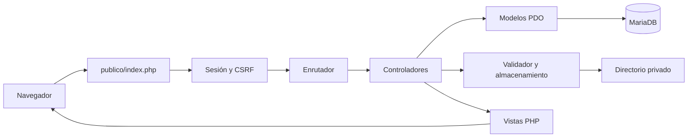

<p align="center">
  
</p>

<p align="center">
  <a href="https://www.php.net/downloads.php?os=windows"></a>
  <a href="https://mariadb.org/"></a>
  <a href="https://getbootstrap.com/"></a>
  <a href="https://www.apachefriends.org/es/download.html"></a>
</p>

<h1 align="center">Control de archivos</h1>
<p align="center">Gestión de documentos personales con PHP, MariaDB y almacenamiento privado.</p>
<p align="center"><strong>Autor:</strong> <a href="https://github.com/castilloleongustavo-eng">castilloleongustavo-eng</a> · <strong>Repositorio destino:</strong> <code>control-de-archivos</code></p>

## 📑 Contenido

- [Descripción y funciones](#-descripción-y-funciones)
- [Requisitos y descargas](#-requisitos-y-descargas)
- [Arranque en esta computadora](#-arranque-en-esta-computadora)
- [Instalación desde cero](#-instalación-desde-cero)
- [Configuración local](#-configuración-local)
- [Base de datos y almacenamiento](#-base-de-datos-y-almacenamiento)
- [Organización y funcionamiento](#-organización-y-funcionamiento)
- [Uso de la aplicación](#-uso-de-la-aplicación)
- [Diagnóstico y solución de problemas](#-diagnóstico-y-solución-de-problemas)
- [Subir el proyecto a GitHub](#-subir-el-proyecto-a-github)
- [Bibliotecas y licencias](#-bibliotecas-y-licencias)

## 🗂️ Descripción y funciones

Control de archivos permite administrar documentos desde una cuenta personal. Cada usuario puede consultar únicamente los archivos que le pertenecen.

| Función | Comportamiento |
| --- | --- |
| Crear cuenta | Registro con usuario, correo y contraseña confirmada |
| Iniciar sesión | Acceso mediante nombre de usuario o correo electrónico |
| Mis documentos | Listado, búsqueda por nombre y filtro por tipo |
| Subir documento | Carga desde la opción del menú lateral |
| Vista previa | Lectura dentro del navegador sin enviar documentos a terceros |
| Descargar | Entrega del archivo original después de comprobar el propietario |
| Eliminar | Confirmación previa y comprobación de sesión, propietario y CSRF |
| Cerrar sesión | Destrucción de la sesión y su cookie |

La interfaz utiliza fondo de estrellas, menús sencillos, iconos claros y botones rojos. Se adapta a computadora, tableta y teléfono.

**Formatos permitidos:** PDF, JPG/JPEG, PNG, TXT UTF-8, DOCX y XLSX. **Tamaño máximo:** 10 MB por archivo, equivalente a 10 485 760 bytes.

## 🧰 Requisitos y descargas

La instalación descrita utiliza **Windows x64** y PowerShell.

| Requisito | Para qué se utiliza | Descarga oficial |
| --- | --- | --- |
| XAMPP | Apache, MariaDB y panel de control | **[Descargar XAMPP para Windows](https://www.apachefriends.org/es/download.html)** |
| PHP 8.5.12 x64 Thread Safe, VS17 | Motor PHP propio del proyecto | [Descargas oficiales de PHP para Windows](https://www.php.net/downloads.php?os=windows) |
| Visual C++ Redistributable x64 | Dependencia del motor PHP para Windows | [Instalador oficial de Microsoft](https://aka.ms/vs/17/release/vc_redist.x64.exe) |
| Git para Windows | Clonar el repositorio y subir cambios | [Descargar Git](https://git-scm.com/downloads/win) |
| Navegador | Usar la aplicación y los lectores de documentos | Chrome, Edge o Firefox actualizado |

El proyecto usa el Apache y MariaDB de XAMPP, pero carga su propio PHP desde `herramientas/ejecucion/php-8.5.12`. El PHP que trae XAMPP puede tener otra versión; no se reemplazan sus DLL ni se cambia el PATH global del equipo.

Extensiones necesarias: `pdo_mysql`, `fileinfo`, `mbstring`, `openssl` y `zip`. No se necesitan Node.js, Composer ni frameworks PHP.

## ▶️ Arranque en esta computadora

La conexión y el PHP local ya están preparados en esta instalación:

1. Abre el panel de XAMPP e inicia **MySQL**.
2. Abre PowerShell en la carpeta del proyecto.
3. Ejecuta:

   ```powershell
   powershell -NoProfile -ExecutionPolicy Bypass -File .\herramientas\servidor.ps1
   ```

4. Abre **http://127.0.0.1:8088/ingresar**.

No necesitas mover el proyecto a `htdocs`. El servidor publica únicamente la carpeta `publico/`.

### Cuentas de demostración local

| Usuario | Contraseña |
| --- | --- |
| `usuario1` | `Pruebas12026` |
| `usuario2` | `Pruebas22026` |

Estas cuentas son para demostrar el funcionamiento. También puedes registrar una cuenta desde el login. Las contraseñas se guardan como hashes; los valores anteriores pertenecen únicamente a las cuentas de demostración.

## 📦 Instalación desde cero

### 1. Obtener el proyecto

Una vez creado el repositorio en la cuenta indicada:

```powershell
git clone https://github.com/castilloleongustavo-eng/control-de-archivos.git
cd control-de-archivos
```

Si descargaste un ZIP desde GitHub, extráelo y abre PowerShell en la carpeta que contiene este README.

### 2. Instalar y abrir XAMPP

Descarga el instalador desde **[Apache Friends](https://www.apachefriends.org/es/download.html)**, instala XAMPP y abre su panel de control. La ruta utilizada por defecto en los scripts es `C:\xampp`.

Inicia **MySQL**. No necesitas iniciar el Apache del panel para usar el puerto 8088 del proyecto. Si utilizas XAMPP para otros proyectos, el servidor de Control de archivos funciona como una instancia aparte.

### 3. Preparar el PHP local

Instala Visual C++ Redistributable x64 si el equipo todavía no dispone de él. Después revisa el plan de descarga:

```powershell
powershell -NoProfile -ExecutionPolicy Bypass -File .\herramientas\preparar-php.ps1
```

Para descargar, verificar y extraer PHP:

```powershell
powershell -NoProfile -ExecutionPolicy Bypass -File .\herramientas\preparar-php.ps1 -Instalar
```

El script utiliza el paquete oficial **PHP 8.5.12 VS17 x64 Thread Safe**, verifica su SHA-256, habilita las extensiones y establece los límites de carga. Los paquetes NTS no corresponden a esta integración con Apache. Si el directorio de PHP ya existe, el script se detiene para conservarlo.

El motor PHP y los ZIP no se incluyen en GitHub; `.gitignore` los excluye. Por eso este paso es necesario después de clonar en otra computadora.

### 4. Preparar MariaDB

**Instalación nueva, sin una base `documentos` existente:**

```powershell
powershell -NoProfile -ExecutionPolicy Bypass -File .\herramientas\configurar.ps1 -Crear
```

**Si la base `documentos` ya existe y quieres conservar sus datos:**

```powershell
powershell -NoProfile -ExecutionPolicy Bypass -File .\herramientas\configurar.ps1
```

El asistente solicita en la consola la contraseña administrativa de MariaDB sin mostrarla. Para otra cuenta administrativa o puerto:

```powershell
powershell -NoProfile -ExecutionPolicy Bypass -File .\herramientas\configurar.ps1 -Usuario administrador -Servidor 127.0.0.1 -Puerto 3306
```

El instalador prepara la cuenta técnica `documentos_app` con permisos limitados y guarda su contraseña en `configuracion/configuracion.env`. La contraseña administrativa no se guarda ni se utiliza para atender peticiones web. La configuración existente no se sobrescribe.

### 5. Crear usuarios de demostración, si los necesitas

```powershell
& .\herramientas\ejecucion\php-8.5.12\php.exe .\base_datos\datos_prueba\usuarios.php --demostracion
```

La semilla crea `usuario1` y `usuario2` con las contraseñas indicadas en este README. Si esas cuentas ya existen, se conservan sin modificar sus contraseñas ni documentos.

### 6. Validar e iniciar

```powershell
powershell -NoProfile -ExecutionPolicy Bypass -File .\herramientas\servidor.ps1 -Accion validar
powershell -NoProfile -ExecutionPolicy Bypass -File .\herramientas\servidor.ps1
```

Abre **http://127.0.0.1:8088/ingresar**. Las rutas funcionan sin `.htaccess`, porque el lanzador configura la entrada `publico/index.php` mediante `FallbackResource`.

## ⚙️ Configuración local

El archivo que utiliza la aplicación es **[`configuracion/configuracion.env`](configuracion/configuracion.env.example)**. El enlace muestra la plantilla, porque el archivo real contiene credenciales y **no se publica en GitHub**.

La plantilla disponible es [`configuracion/configuracion.env.example`](configuracion/configuracion.env.example). El asistente crea el archivo real; para una configuración manual con una cuenta técnica ya preparada, duplica la plantilla con el nombre `configuracion.env`, únicamente si ese archivo todavía no existe, y completa sus valores.

```ini
NOMBRE_APLICACION=Control de archivos
BD_SERVIDOR=127.0.0.1
BD_PUERTO=3306
BD_NOMBRE=documentos
BD_USUARIO=documentos_app
BD_CONTRASENA=CONTRASENA_LOCAL_DE_LA_CUENTA_TECNICA
SESION_INACTIVIDAD=1800
RUTA_DATOS=C:/AlmacenamientoPrivado/GestorArchivos
RUTA_DOCUMENTOS=C:/AlmacenamientoPrivado/GestorArchivos/documentos
```

| Variable | Significado |
| --- | --- |
| `NOMBRE_APLICACION` | Nombre visible en la pestaña del navegador y el menú |
| `BD_SERVIDOR`, `BD_PUERTO` | Dirección y puerto de MariaDB |
| `BD_NOMBRE` | Base utilizada por la aplicación |
| `BD_USUARIO`, `BD_CONTRASENA` | Credenciales privadas de la cuenta técnica |
| `SESION_INACTIVIDAD` | Caducidad de la sesión, en segundos; 1800 equivale a 30 minutos |
| `RUTA_DATOS` | Directorio externo para sesiones, registros y temporales |
| `RUTA_DOCUMENTOS` | Directorio externo de los archivos cargados |

El formato es `CLAVE=valor`, sin comillas. Las variables definidas en el proceso tienen prioridad. `DOCUMENTOS_ENTORNO` permite seleccionar otro archivo de configuración; por defecto se usa el de `configuracion/`.

La configuración anterior ubicada en `C:\AlmacenamientoPrivado\GestorArchivos\configuracion.env` se conserva como copia local, pero ya no es la ruta predeterminada de lectura.

## 🗄️ Base de datos y almacenamiento

### Tablas

| Tabla | Información |
| --- | --- |
| `usuarios` | Nombre, correo, hash de contraseña y fechas |
| `documentos` | ID, propietario, nombre original, nombre físico, MIME, extensión, tamaño y fecha |
| `intentos_autenticacion` | Contadores por categoría e IP para limitar intentos |

Los archivos SQL están en `base_datos/estructura/`: `crear_base.sql`, `esquema.sql` y `relaciones.sql`. El instalador los aplica en ese orden. Las relaciones vinculan cada documento con su usuario mediante `id_usuario`.

### Archivos físicos y datos de ejecución

```text
C:\AlmacenamientoPrivado\GestorArchivos\
├── documentos\    Archivos privados por ID de usuario
├── sesiones\      Sesiones PHP y tokens CSRF
├── registros\     Errores PHP y registro de Apache
└── temporal\      Configuración y PID de Apache; cargas temporales
```

Un documento físico se guarda como `documentos/<id_usuario>/<nombre_aleatorio>`, sin extensión. MySQL conserva su nombre original y los demás metadatos. La aplicación comprueba el propietario antes de permitir vista previa, descarga o eliminación.

Los archivos de ejecución permanecen fuera del proyecto. Para respaldar una instalación, guarda conjuntamente la base de datos, el directorio de documentos y tu configuración privada. Cambiar `RUTA_DOCUMENTOS` no mueve los archivos existentes.

## 🧩 Organización y funcionamiento

```text
control-de-archivos/
├── aplicacion/
│   ├── controladores/       Reciben solicitudes y coordinan las operaciones
│   ├── modelos/             Consultas preparadas y acceso a MariaDB
│   ├── servicios/           Gestión del disco y límites de intentos
│   ├── intermediarios/      Sesión, CSRF y cabeceras de seguridad
│   ├── validadores/         Revisión del contenido de los archivos
│   ├── nucleo/              Conexión PDO, rutas HTTP, sesiones y vistas
│   ├── vistas/              Formularios y pantallas PHP
│   └── inicio.php           Configuración y autocarga
├── base_datos/               SQL, instalador y semilla de demostración
├── configuracion/            Configuración local, rutas, formatos y límites
├── herramientas/             Scripts de preparación, arranque y diagnóstico
├── publico/                  Única carpeta publicada por Apache
├── .gitignore                Exclusiones de credenciales y archivos locales
└── README.md
```



`Conexion.php` obtiene una única conexión PDO por petición. Los modelos utilizan parámetros preparados. Los controladores coordinan validación, acceso y respuesta; las vistas muestran los datos escapados. Los comentarios del código explican las responsabilidades, los parámetros y las condiciones de seguridad.

### Rutas de la aplicación

| Ruta | Método | Uso |
| --- | --- | --- |
| `/ingresar` | GET / POST | Formulario y acceso |
| `/registrarse` | GET / POST | Formulario y registro |
| `/salir` | POST | Cerrar sesión |
| `/` y `/documentos` | GET | Consulta de archivos propios |
| `/documentos/subir` | GET / POST | Formulario y carga |
| `/documentos/{id}/vista-previa` | GET | Pantalla de lectura |
| `/documentos/{id}/ver` | GET | Contenido autorizado para el visor |
| `/documentos/{id}/descargar` | GET | Descarga del original |
| `/documentos/{id}/eliminar` | POST | Eliminación con CSRF |

## 👁️ Uso de la aplicación

1. Inicia sesión o registra una cuenta.
2. Entra en **Subir documento**, selecciona un archivo permitido y pulsa **Guardar archivo**.
3. Consulta tus archivos en **Mis documentos**; utiliza la búsqueda o el filtro si lo necesitas.
4. Pulsa el nombre o el icono del ojo para abrir la vista previa.
5. Utiliza el icono de descarga para conservar una copia local.
6. Para eliminar, pulsa la papelera y confirma en el diálogo.

| Tipo | Vista previa |
| --- | --- |
| PDF | Páginas dibujadas en canvas con navegación |
| JPG/JPEG y PNG | Imagen dentro del panel |
| TXT | Texto UTF-8 con saltos de línea |
| DOCX | Párrafos, títulos, tablas e imágenes incluidas |
| XLSX | Selección de hoja y navegación por bloques de filas y columnas |

Las vistas de Word y Excel son de lectura simplificada. No reproducen todos los estilos, gráficos o la paginación de Office. Las fórmulas muestran el resultado guardado, o su texto si no existe resultado; no se recalculan. Los PDF cifrados o documentos que no puedan mostrarse se pueden descargar.

## 🔎 Diagnóstico y solución de problemas

```powershell
# Comprobar PHP, extensiones, conexión SQL y configuración de Apache.
powershell -NoProfile -ExecutionPolicy Bypass -File .\herramientas\servidor.ps1 -Accion validar

# Consultar la instancia del proyecto.
powershell -NoProfile -ExecutionPolicy Bypass -File .\herramientas\servidor.ps1 -Accion estado

# Detener solo esta instancia.
powershell -NoProfile -ExecutionPolicy Bypass -File .\herramientas\servidor.ps1 -Accion detener
```

Para otra ubicación de XAMPP o un puerto HTTP diferente:

```powershell
powershell -NoProfile -ExecutionPolicy Bypass -File .\herramientas\servidor.ps1 -Xampp D:\xampp -Puerto 8089
```

| Problema | Qué revisar |
| --- | --- |
| No abre el enlace | Que el script haya iniciado Apache y que uses el puerto indicado |
| No conecta a la base | MySQL iniciado, base existente y valores de `configuracion/configuracion.env` |
| Falta PHP local | Ejecutar `herramientas/preparar-php.ps1 -Instalar` en una instalación nueva |
| PHP no inicia o faltan DLL | Windows x64, paquete TS, Visual C++ Redistributable x64 y extracción completa |
| El puerto está ocupado | Usar `-Puerto` con otro puerto libre; el script no detiene procesos ajenos |
| No se actualiza el diseño | Recargar con `Ctrl + F5` |
| No encuentra documentos antiguos | Comprobar que `RUTA_DOCUMENTOS` apunta al almacén original |
| El archivo no se acepta | Formato, contenido real y límite de tamaño; Office no admite macros o incrustaciones |

Los errores privados están en `C:\AlmacenamientoPrivado\GestorArchivos\registros\php.log` y `apache-local.log`. No se muestran contraseñas, SQL ni rutas internas al usuario web.

Para diagnosticar la correspondencia entre MySQL y el disco, sin modificar datos:

```powershell
& .\herramientas\ejecucion\php-8.5.12\php.exe .\herramientas\mantenimiento\reconciliar_documentos.php
```

`-ExecutionPolicy Bypass` afecta únicamente al proceso invocado. Los scripts no cambian la política de PowerShell ni la configuración global de XAMPP.

## 🐙 Subir el proyecto a GitHub

El repositorio del proyecto es **[castilloleongustavo-eng/control-de-archivos](https://github.com/castilloleongustavo-eng/control-de-archivos)**. Su acceso es privado. Los siguientes pasos permiten configurar otra copia local y publicar cambios con una cuenta autorizada.

1. Inicia sesión en GitHub como **[castilloleongustavo-eng](https://github.com/castilloleongustavo-eng)**.
2. Abre el repositorio y comprueba que tu cuenta tenga acceso.
3. Para trabajar desde otro equipo, clona el repositorio: `git clone https://github.com/castilloleongustavo-eng/control-de-archivos.git`. Después entra en `control-de-archivos` y sigue la instalación indicada en este documento.
4. En la carpeta del proyecto, revisa las exclusiones y el contenido que vas a subir:

   ```powershell
   git status --short
   git check-ignore configuracion/configuracion.env
   git add .
   git diff --cached --name-only
   ```

   El archivo real `configuracion/configuracion.env` no debe aparecer entre los archivos preparados. La plantilla `.example` sí se comparte. Tampoco se suben el motor PHP, sesiones, registros ni documentos personales.

5. Configura tu identidad local si todavía no está definida. Sustituye el correo por el verificado en tu cuenta o por tu dirección privada de GitHub:

   ```powershell
   git config user.name "Gustavo Castillo"
   git config user.email "TU_CORREO_VERIFICADO_EN_GITHUB"
   ```

6. Guarda los cambios y publica la rama:

   ```powershell
   git commit -m "Preparar Control de archivos"
   git branch -M main
   git remote add origin https://github.com/castilloleongustavo-eng/control-de-archivos.git
   git push -u origin main
   ```

   Si ya existe `origin`, utiliza `git remote set-url origin https://github.com/castilloleongustavo-eng/control-de-archivos.git` en lugar de añadirlo. Completa la autenticación con la cuenta que tiene acceso al repositorio.

GitHub aloja el código. La aplicación necesita PHP, Apache y MariaDB para ejecutarse; GitHub Pages no ejecuta este backend PHP.

## 📚 Bibliotecas y licencias

| Recurso | Uso | Licencia incluida |
| --- | --- | --- |
| Bootstrap 5.3.8 | Estilos y controles | `publico/recursos/estilos/bootstrap.LICENSE` |
| PDF.js 6.4.299 | Lectura de PDF | `publico/recursos/externos/pdfjs/LICENSE` |
| fflate 0.8.2 | Lectura de contenedores DOCX/XLSX | `publico/recursos/externos/fflate/LICENSE` |

Las bibliotecas se conservan con sus licencias y se sirven localmente durante el uso de la aplicación. Los logotipos de las tecnologías en este README se muestran mediante Shields.io. El fondo de estrellas corresponde a la fotografía de [Antonin Carvalho en Unsplash](https://unsplash.com/photos/blue-and-black-starry-night-sky-xKfr5ApMYbg), bajo [licencia Unsplash](https://unsplash.com/license).

---

<p align="center"><strong>Control de archivos</strong><br><a href="https://github.com/castilloleongustavo-eng">Gustavo Castillo · castilloleongustavo-eng</a></p>
