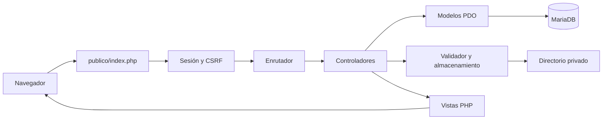

<p align="center">
  
</p>

<p align="center">
  <a href="https://www.php.net/downloads.php?os=windows"></a>
  <a href="https://mariadb.org/"></a>
  <a href="https://getbootstrap.com/"></a>
  <a href="https://www.apachefriends.org/es/download.html"></a>
</p>

<h1 align="center">Control de archivos</h1>
<p align="center">Gestión de documentos personales con PHP, MariaDB y almacenamiento privado.</p>
<p align="center"><strong>Autor:</strong> <a href="https://github.com/castilloleongustavo-eng">castilloleongustavo-eng</a> · <strong>Repositorio destino:</strong> <code>control-de-archivos</code></p>

## 📑 Contenido

- [Descripción y funciones](#-descripción-y-funciones)
- [Requisitos y descargas](#-requisitos-y-descargas)
- [Arranque en esta computadora](#-arranque-en-esta-computadora)
- [Instalación desde cero](#-instalación-desde-cero)
- [Configuración local](#-configuración-local)
- [Base de datos y almacenamiento](#-base-de-datos-y-almacenamiento)
- [Organización y funcionamiento](#-organización-y-funcionamiento)
- [Uso de la aplicación](#-uso-de-la-aplicación)
- [Diagnóstico y solución de problemas](#-diagnóstico-y-solución-de-problemas)
- [Subir el proyecto a GitHub](#-subir-el-proyecto-a-github)
- [Bibliotecas y licencias](#-bibliotecas-y-licencias)

## 🗂️ Descripción y funciones

Control de archivos permite administrar documentos desde una cuenta personal. Cada usuario puede consultar únicamente los archivos que le pertenecen.

| Función | Comportamiento |
| --- | --- |
| Crear cuenta | Registro con usuario, correo y contraseña confirmada |
| Iniciar sesión | Acceso mediante nombre de usuario o correo electrónico |
| Mis documentos | Listado, búsqueda por nombre y filtro por tipo |
| Subir documento | Carga desde la opción del menú lateral |
| Vista previa | Lectura dentro del navegador sin enviar documentos a terceros |
| Descargar | Entrega del archivo original después de comprobar el propietario |
| Eliminar | Confirmación previa y comprobación de sesión, propietario y CSRF |
| Cerrar sesión | Destrucción de la sesión y su cookie |

La interfaz utiliza fondo de estrellas, menús sencillos, iconos claros y botones rojos. Se adapta a computadora, tableta y teléfono.

**Formatos permitidos:** PDF, JPG/JPEG, PNG, TXT UTF-8, DOCX y XLSX. **Tamaño máximo:** 10 MB por archivo, equivalente a 10 485 760 bytes.

## 🧰 Requisitos y descargas

La instalación descrita utiliza **Windows x64** y PowerShell.

| Requisito | Para qué se utiliza | Descarga oficial |
| --- | --- | --- |
| XAMPP | Apache, MariaDB y panel de control | **[Descargar XAMPP para Windows](https://www.apachefriends.org/es/download.html)** |
| PHP 8.5.12 x64 Thread Safe, VS17 | Motor PHP propio del proyecto | [Descargas oficiales de PHP para Windows](https://www.php.net/downloads.php?os=windows) |
| Visual C++ Redistributable x64 | Dependencia del motor PHP para Windows | [Instalador oficial de Microsoft](https://aka.ms/vs/17/release/vc_redist.x64.exe) |
| Git para Windows | Clonar el repositorio y subir cambios | [Descargar Git](https://git-scm.com/downloads/win) |
| Navegador | Usar la aplicación y los lectores de documentos | Chrome, Edge o Firefox actualizado |

El proyecto usa el Apache y MariaDB de XAMPP, pero carga su propio PHP desde `herramientas/ejecucion/php-8.5.12`. El PHP que trae XAMPP puede tener otra versión; no se reemplazan sus DLL ni se cambia el PATH global del equipo.

Extensiones necesarias: `pdo_mysql`, `fileinfo`, `mbstring`, `openssl` y `zip`. No se necesitan Node.js, Composer ni frameworks PHP.

## ▶️ Arranque en esta computadora

La conexión y el PHP local ya están preparados en esta instalación:

1. Abre el panel de XAMPP e inicia **MySQL**.
2. Abre PowerShell en la carpeta del proyecto.
3. Ejecuta:

   ```powershell
   powershell -NoProfile -ExecutionPolicy Bypass -File .\herramientas\servidor.ps1
   ```

4. Abre **http://127.0.0.1:8088/ingresar**.

No necesitas mover el proyecto a `htdocs`. El servidor publica únicamente la carpeta `publico/`.

### Cuentas de demostración local

| Usuario | Contraseña |
| --- | --- |
| `usuario1` | `Pruebas12026` |
| `usuario2` | `Pruebas22026` |

Estas cuentas son para demostrar el funcionamiento. También puedes registrar una cuenta desde el login. Las contraseñas se guardan como hashes; los valores anteriores pertenecen únicamente a las cuentas de demostración.

## 📦 Instalación desde cero

### 1. Obtener el proyecto

Una vez creado el repositorio en la cuenta indicada:

```powershell
git clone https://github.com/castilloleongustavo-eng/control-de-archivos.git
cd control-de-archivos
```

Si descargaste un ZIP desde GitHub, extráelo y abre PowerShell en la carpeta que contiene este README.

### 2. Instalar y abrir XAMPP

Descarga el instalador desde **[Apache Friends](https://www.apachefriends.org/es/download.html)**, instala XAMPP y abre su panel de control. La ruta utilizada por defecto en los scripts es `C:\xampp`.

Inicia **MySQL**. No necesitas iniciar el Apache del panel para usar el puerto 8088 del proyecto. Si utilizas XAMPP para otros proyectos, el servidor de Control de archivos funciona como una instancia aparte.

### 3. Preparar el PHP local

Instala Visual C++ Redistributable x64 si el equipo todavía no dispone de él. Después revisa el plan de descarga:

```powershell
powershell -NoProfile -ExecutionPolicy Bypass -File .\herramientas\preparar-php.ps1
```

Para descargar, verificar y extraer PHP:

```powershell
powershell -NoProfile -ExecutionPolicy Bypass -File .\herramientas\preparar-php.ps1 -Instalar
```

El script utiliza el paquete oficial **PHP 8.5.12 VS17 x64 Thread Safe**, verifica su SHA-256, habilita las extensiones y establece los límites de carga. Los paquetes NTS no corresponden a esta integración con Apache. Si el directorio de PHP ya existe, el script se detiene para conservarlo.

El motor PHP y los ZIP no se incluyen en GitHub; `.gitignore` los excluye. Por eso este paso es necesario después de clonar en otra computadora.

### 4. Preparar MariaDB

**Instalación nueva, sin una base `documentos` existente:**

```powershell
powershell -NoProfile -ExecutionPolicy Bypass -File .\herramientas\configurar.ps1 -Crear
```

**Si la base `documentos` ya existe y quieres conservar sus datos:**

```powershell
powershell -NoProfile -ExecutionPolicy Bypass -File .\herramientas\configurar.ps1
```

El asistente solicita en la consola la contraseña administrativa de MariaDB sin mostrarla. Para otra cuenta administrativa o puerto:

```powershell
powershell -NoProfile -ExecutionPolicy Bypass -File .\herramientas\configurar.ps1 -Usuario administrador -Servidor 127.0.0.1 -Puerto 3306
```

El instalador prepara la cuenta técnica `documentos_app` con permisos limitados y guarda su contraseña en `configuracion/configuracion.env`. La contraseña administrativa no se guarda ni se utiliza para atender peticiones web. La configuración existente no se sobrescribe.

### 5. Crear usuarios de demostración, si los necesitas

```powershell
& .\herramientas\ejecucion\php-8.5.12\php.exe .\base_datos\datos_prueba\usuarios.php --demostracion
```

La semilla crea `usuario1` y `usuario2` con las contraseñas indicadas en este README. Si esas cuentas ya existen, se conservan sin modificar sus contraseñas ni documentos.

### 6. Validar e iniciar

```powershell
powershell -NoProfile -ExecutionPolicy Bypass -File .\herramientas\servidor.ps1 -Accion validar
powershell -NoProfile -ExecutionPolicy Bypass -File .\herramientas\servidor.ps1
```

Abre **http://127.0.0.1:8088/ingresar**. Las rutas funcionan sin `.htaccess`, porque el lanzador configura la entrada `publico/index.php` mediante `FallbackResource`.

## ⚙️ Configuración local

El archivo que utiliza la aplicación es **[`configuracion/configuracion.env`](configuracion/configuracion.env.example)**. El enlace muestra la plantilla, porque el archivo real contiene credenciales y **no se publica en GitHub**.

La plantilla disponible es [`configuracion/configuracion.env.example`](configuracion/configuracion.env.example). El asistente crea el archivo real; para una configuración manual con una cuenta técnica ya preparada, duplica la plantilla con el nombre `configuracion.env`, únicamente si ese archivo todavía no existe, y completa sus valores.

Las plantillas de entorno y PHP, junto con el inventario de archivos ocultos y generados, también están reunidas en la [guía de configuración local](documentacion/configuracion-local/README.md).

```ini
NOMBRE_APLICACION=Control de archivos
BD_SERVIDOR=127.0.0.1
BD_PUERTO=3306
BD_NOMBRE=documentos
BD_USUARIO=documentos_app
BD_CONTRASENA=CONTRASENA_LOCAL_DE_LA_CUENTA_TECNICA
SESION_INACTIVIDAD=1800
RUTA_DATOS=C:/AlmacenamientoPrivado/GestorArchivos
RUTA_DOCUMENTOS=C:/AlmacenamientoPrivado/GestorArchivos/documentos
```

| Variable | Significado |
| --- | --- |
| `NOMBRE_APLICACION` | Nombre visible en la pestaña del navegador y el menú |
| `BD_SERVIDOR`, `BD_PUERTO` | Dirección y puerto de MariaDB |
| `BD_NOMBRE` | Base utilizada por la aplicación |
| `BD_USUARIO`, `BD_CONTRASENA` | Credenciales privadas de la cuenta técnica |
| `SESION_INACTIVIDAD` | Caducidad de la sesión, en segundos; 1800 equivale a 30 minutos |
| `RUTA_DATOS` | Directorio externo para sesiones, registros y temporales |
| `RUTA_DOCUMENTOS` | Directorio externo de los archivos cargados |

El formato es `CLAVE=valor`, sin comillas. Las variables definidas en el proceso tienen prioridad. `DOCUMENTOS_ENTORNO` permite seleccionar otro archivo de configuración; por defecto se usa el de `configuracion/`.

La configuración anterior ubicada en `C:\AlmacenamientoPrivado\GestorArchivos\configuracion.env` se conserva como copia local, pero ya no es la ruta predeterminada de lectura.

## 🗄️ Base de datos y almacenamiento

### Tablas

| Tabla | Información |
| --- | --- |
| `usuarios` | Nombre, correo, hash de contraseña y fechas |
| `documentos` | ID, propietario, nombre original, nombre físico, MIME, extensión, tamaño y fecha |
| `intentos_autenticacion` | Contadores por categoría e IP para limitar intentos |

Los archivos SQL están en `base_datos/estructura/`: `crear_base.sql`, `esquema.sql` y `relaciones.sql`. El instalador los aplica en ese orden. Las relaciones vinculan cada documento con su usuario mediante `id_usuario`.

### Archivos físicos y datos de ejecución

```text
C:\AlmacenamientoPrivado\GestorArchivos\
├── documentos\    Archivos privados por ID de usuario
├── sesiones\      Sesiones PHP y tokens CSRF
├── registros\     Errores PHP y registro de Apache
└── temporal\      Configuración y PID de Apache; cargas temporales
```

Un documento físico se guarda como `documentos/<id_usuario>/<nombre_aleatorio>`, sin extensión. MySQL conserva su nombre original y los demás metadatos. La aplicación comprueba el propietario antes de permitir vista previa, descarga o eliminación.

Los archivos de ejecución permanecen fuera del proyecto. Para respaldar una instalación, guarda conjuntamente la base de datos, el directorio de documentos y tu configuración privada. Cambiar `RUTA_DOCUMENTOS` no mueve los archivos existentes.

## 🧩 Organización y funcionamiento

El proyecto separa la lógica PHP, la base de datos, la configuración, las herramientas y la carpeta pública. Este mapa incluye todas las carpetas del código publicable y, debajo, el inventario de sus **254 archivos**.

**Detalle adicional:** [Componente extra solicitado](#componente-extra-solicitado).

**Accesos rápidos:** [Carpetas](#directorio-de-carpetas) · [Funcionamiento](#flujo-de-funcionamiento) · [Archivos y componentes](#inventario-de-archivos-y-componentes) · [Configuración y archivos ocultos](#configuración-local-archivos-ocultos-y-datos-de-ejecución)

> **Navegación en GitHub:** los nombres de carpetas y las rutas de archivos son enlaces relativos al repositorio. Al leer este README en GitHub abren el elemento correspondiente en la misma rama; también funcionan al navegar una copia local con un visor Markdown compatible. Las plantillas de configuración se publican junto con la documentación; cada instalación completa sus credenciales localmente.

### Flujo de funcionamiento



1. [publico/index.php](publico/index.php) recibe la solicitud y carga [aplicacion/inicio.php](aplicacion/inicio.php), que prepara configuración, autocarga y rutas privadas.
2. [aplicacion/nucleo/Sesion.php](aplicacion/nucleo/Sesion.php) abre la sesión; [aplicacion/intermediarios/Seguridad.php](aplicacion/intermediarios/Seguridad.php) aplica las comprobaciones de identidad y CSRF cuando corresponde.
3. [aplicacion/nucleo/Enrutador.php](aplicacion/nucleo/Enrutador.php) selecciona el controlador según la URL y el método HTTP.
4. Los [controladores](aplicacion/controladores/) coordinan las operaciones. Los [modelos](aplicacion/modelos/) consultan MariaDB mediante [aplicacion/nucleo/Conexion.php](aplicacion/nucleo/Conexion.php); [aplicacion/servicios/AlmacenDocumentos.php](aplicacion/servicios/AlmacenDocumentos.php) y [aplicacion/validadores/ValidadorDocumento.php](aplicacion/validadores/ValidadorDocumento.php) gestionan los archivos privados.
5. [aplicacion/nucleo/Vista.php](aplicacion/nucleo/Vista.php) combina una plantilla con [aplicacion/vistas/componentes/estructura.php](aplicacion/vistas/componentes/estructura.php), donde están el sidebar, la cabecera y la carga de recursos.

**Cambios frecuentes:** el menú lateral se modifica en [aplicacion/vistas/componentes/estructura.php](aplicacion/vistas/componentes/estructura.php); las rutas, en [aplicacion/nucleo/Enrutador.php](aplicacion/nucleo/Enrutador.php); los formatos permitidos, en [configuracion/almacenamiento/formatos.php](configuracion/almacenamiento/formatos.php); y los límites, en [configuracion/seguridad/parametros.php](configuracion/seguridad/parametros.php).

### Componente extra solicitado

Este componente documental amplía la organización del proyecto con un mapa de **37 directorios**, un inventario de **254 archivos** y la explicación de los recursos locales necesarios para ejecutarlo. Las tablas separan la descripción, la ubicación exacta dentro del proyecto y el enlace de consulta en GitHub. Incluyen código propio, vistas, estilos, scripts, SQL, herramientas, imágenes, iconos y todos los archivos de las bibliotecas externas.

| Contenido | Qué permite localizar |
| --- | --- |
| [Mapa de carpetas](#mapa-completo-de-carpetas) | Jerarquía completa del código publicable. |
| [Directorio de carpetas](#directorio-de-carpetas) | Responsabilidad, ubicación y enlace de cada directorio. |
| [Inventario de archivos](#inventario-de-archivos-y-componentes) | Cada archivo y componente con su descripción, funcionamiento, ruta y enlace. |
| [Archivos locales y ocultos](#configuración-local-archivos-ocultos-y-datos-de-ejecución) | Configuración de entorno, motor PHP, reglas Apache y datos generados. |
| [Plantillas de configuración](documentacion/configuracion-local/README.md) | Preparación de entorno y PHP con ejemplos publicables. |

#### Mapa completo de carpetas

```text
control-de-archivos/
├── aplicacion/
│   ├── controladores/
│   ├── intermediarios/
│   ├── modelos/
│   ├── nucleo/
│   ├── servicios/
│   ├── validadores/
│   └── vistas/
│       ├── autenticacion/
│       ├── componentes/
│       └── documentos/
├── base_datos/
│   ├── datos_prueba/
│   ├── estructura/
│   └── migraciones/
├── configuracion/
│   ├── almacenamiento/
│   ├── seguridad/
│   └── servidor/
├── documentacion/
│   └── configuracion-local/
├── herramientas/
│   ├── diagnostico/
│   ├── instalacion/
│   └── mantenimiento/
└── publico/
    └── recursos/
        ├── estilos/
        ├── externos/
        │   ├── fflate/
        │   └── pdfjs/
        │       ├── build/
        │       ├── cmaps/
        │       └── standard_fonts/
        ├── iconos/
        ├── imagenes/
        └── scripts/
```

Los archivos de la raíz son [.gitignore](.gitignore) y [README.md](README.md). Los motores descargados y datos privados de la instalación se describen en la tabla de archivos locales, porque no forman parte del código publicable.

#### Directorio de carpetas

| Directorio | Descripción y responsabilidad | Ubicación dentro del proyecto | Enlace |
| --- | --- | --- | --- |
| aplicacion | Lógica PHP de la aplicación, organizada por responsabilidad. | `aplicacion/` | [Ver carpeta en GitHub](aplicacion/) |
| controladores | Reciben peticiones y coordinan autenticación, documentos y respuestas. | `aplicacion/controladores/` | [Ver carpeta en GitHub](aplicacion/controladores/) |
| intermediarios | Comprobaciones compartidas de sesión, CSRF y cabeceras HTTP. | `aplicacion/intermediarios/` | [Ver carpeta en GitHub](aplicacion/intermediarios/) |
| modelos | Consultas preparadas y acceso a las tablas de MariaDB. | `aplicacion/modelos/` | [Ver carpeta en GitHub](aplicacion/modelos/) |
| nucleo | Infraestructura: conexión PDO, enrutador, sesiones, vistas y errores HTTP. | `aplicacion/nucleo/` | [Ver carpeta en GitHub](aplicacion/nucleo/) |
| servicios | Coordinación del almacenamiento privado y límite de intentos. | `aplicacion/servicios/` | [Ver carpeta en GitHub](aplicacion/servicios/) |
| validadores | Inspección de nombres, tamaño, MIME y estructura de documentos. | `aplicacion/validadores/` | [Ver carpeta en GitHub](aplicacion/validadores/) |
| vistas | Plantillas PHP que presentan los datos entregados por los controladores. | `aplicacion/vistas/` | [Ver carpeta en GitHub](aplicacion/vistas/) |
| autenticacion | Formulario compartido de ingreso y registro. | `aplicacion/vistas/autenticacion/` | [Ver carpeta en GitHub](aplicacion/vistas/autenticacion/) |
| componentes | Estructura general, sidebar, cabecera y presentación de errores. | `aplicacion/vistas/componentes/` | [Ver carpeta en GitHub](aplicacion/vistas/componentes/) |
| documentos | Listado, carga y vista previa de documentos. | `aplicacion/vistas/documentos/` | [Ver carpeta en GitHub](aplicacion/vistas/documentos/) |
| base_datos | Esquema SQL, preparación de base y cuentas de demostración. | `base_datos/` | [Ver carpeta en GitHub](base_datos/) |
| datos_prueba | Semilla opcional de usuarios para demostración local. | `base_datos/datos_prueba/` | [Ver carpeta en GitHub](base_datos/datos_prueba/) |
| estructura | Creación de base, tablas, índices y relaciones. | `base_datos/estructura/` | [Ver carpeta en GitHub](base_datos/estructura/) |
| migraciones | Instalador que prepara el esquema y la cuenta técnica. | `base_datos/migraciones/` | [Ver carpeta en GitHub](base_datos/migraciones/) |
| configuracion | Rutas, límites, formatos y plantilla de configuración del entorno. | `configuracion/` | [Ver carpeta en GitHub](configuracion/) |
| almacenamiento | Catálogo de extensiones y tipos MIME permitidos. | `configuracion/almacenamiento/` | [Ver carpeta en GitHub](configuracion/almacenamiento/) |
| seguridad | Límites de archivos y parámetros de seguridad compartidos. | `configuracion/seguridad/` | [Ver carpeta en GitHub](configuracion/seguridad/) |
| servidor | Plantilla de sitio Apache para una instalación convencional. | `configuracion/servidor/` | [Ver carpeta en GitHub](configuracion/servidor/) |
| documentacion | Documentación de apoyo y plantillas publicables de instalación. | `documentacion/` | [Ver carpeta en GitHub](documentacion/) |
| configuracion-local | Guía de archivos locales y ejemplos de entorno y php.ini sin credenciales reales. | `documentacion/configuracion-local/` | [Ver carpeta en GitHub](documentacion/configuracion-local/) |
| herramientas | Scripts de preparación, arranque, diagnóstico y mantenimiento. | `herramientas/` | [Ver carpeta en GitHub](herramientas/) |
| diagnostico | Comprobación de PHP, extensiones, rutas y conexión SQL. | `herramientas/diagnostico/` | [Ver carpeta en GitHub](herramientas/diagnostico/) |
| instalacion | Entrada por consola al instalador de MariaDB. | `herramientas/instalacion/` | [Ver carpeta en GitHub](herramientas/instalacion/) |
| mantenimiento | Reconciliación entre binarios privados y metadatos SQL. | `herramientas/mantenimiento/` | [Ver carpeta en GitHub](herramientas/mantenimiento/) |
| publico | Única raíz web: entrada PHP y recursos que puede solicitar el navegador. | `publico/` | [Ver carpeta en GitHub](publico/) |
| recursos | Estilos, scripts, iconos, imágenes y dependencias del navegador. | `publico/recursos/` | [Ver carpeta en GitHub](publico/recursos/) |
| estilos | Hojas CSS propias y copia local de Bootstrap con su licencia. | `publico/recursos/estilos/` | [Ver carpeta en GitHub](publico/recursos/estilos/) |
| externos | Bibliotecas de terceros servidas desde el mismo sitio. | `publico/recursos/externos/` | [Ver carpeta en GitHub](publico/recursos/externos/) |
| fflate | Lector ZIP para los visores DOCX y XLSX; incluye origen y licencia. | `publico/recursos/externos/fflate/` | [Ver carpeta en GitHub](publico/recursos/externos/fflate/) |
| pdfjs | Motor PDF.js y sus recursos auxiliares y licencias. | `publico/recursos/externos/pdfjs/` | [Ver carpeta en GitHub](publico/recursos/externos/pdfjs/) |
| build | Motor de PDF.js y worker que realiza trabajo de lectura en segundo plano. | `publico/recursos/externos/pdfjs/build/` | [Ver carpeta en GitHub](publico/recursos/externos/pdfjs/build/) |
| cmaps | Mapas de caracteres que PDF.js utiliza para interpretar determinadas fuentes PDF. | `publico/recursos/externos/pdfjs/cmaps/` | [Ver carpeta en GitHub](publico/recursos/externos/pdfjs/cmaps/) |
| standard_fonts | Fuentes estándar PDF y sus licencias para el lector local. | `publico/recursos/externos/pdfjs/standard_fonts/` | [Ver carpeta en GitHub](publico/recursos/externos/pdfjs/standard_fonts/) |
| iconos | Símbolos SVG y favicon de la aplicación. | `publico/recursos/iconos/` | [Ver carpeta en GitHub](publico/recursos/iconos/) |
| imagenes | Imagen de presentación del proyecto y fondo de las pantallas. | `publico/recursos/imagenes/` | [Ver carpeta en GitHub](publico/recursos/imagenes/) |
| scripts | Interacciones de formularios, sidebar y lectores de documentos. | `publico/recursos/scripts/` | [Ver carpeta en GitHub](publico/recursos/scripts/) |

#### Inventario de archivos y componentes

Cada fila identifica un archivo concreto, su componente y su función. Las bibliotecas externas se presentan en tablas desplegables para mantener visible el código propio; se incluyen también todos sus mapas de caracteres, fuentes y licencias.

##### Raíz y documentación

| Componente | Descripción y funcionamiento | Ubicación del archivo | Enlace |
| --- | --- | --- | --- |
| Repositorio | Excluye credenciales, motores locales, registros y paquetes generados del control de versiones. | `.gitignore` | [Ver archivo en GitHub](.gitignore) |
| Repositorio | Guía principal: requisitos, instalación, organización, inventario, uso y diagnóstico. | `README.md` | [Ver archivo en GitHub](README.md) |
| documentación · configuracion-local | Guía de configuración local, archivos ocultos y pasos para utilizar las plantillas. | `documentacion/configuracion-local/README.md` | [Ver archivo en GitHub](documentacion/configuracion-local/README.md) |
| documentación · configuracion-local | Copia publicable de las variables de entorno con valores de ejemplo y contraseña pendiente de completar. Se copia como configuracion.env y se completan sus valores; aplicacion/inicio.php lee cada par CLAVE=valor. | `documentacion/configuracion-local/configuracion.env.example` | [Ver archivo en GitHub](documentacion/configuracion-local/configuracion.env.example) |
| documentación · configuracion-local | Plantilla del motor PHP con extensiones y límites; requiere sustituir sus rutas de ejemplo. | `documentacion/configuracion-local/php.ini.example` | [Ver archivo en GitHub](documentacion/configuracion-local/php.ini.example) |

##### Aplicación PHP

| Componente | Descripción y funcionamiento | Ubicación del archivo | Enlace |
| --- | --- | --- | --- |
| controladores | Atiende el registro, inicio y cierre de sesión. Recibe formularios, valida campos, consulta Usuario y el limitador de intentos, y responde con vistas o redirecciones. | `aplicacion/controladores/ControladorAutenticacion.php` | [Ver archivo en GitHub](aplicacion/controladores/ControladorAutenticacion.php) |
| controladores | Atiende las pantallas y operaciones de documentos del usuario. Solicita datos a Documento, delega los archivos físicos a AlmacenDocumentos y muestra listados, cargas o vistas previas. | `aplicacion/controladores/ControladorDocumentos.php` | [Ver archivo en GitHub](aplicacion/controladores/ControladorDocumentos.php) |
| aplicacion | Inicializa los recursos compartidos de toda la aplicación. Lee el entorno, registra la carga de clases, prepara directorios privados y define funciones de presentación. | `aplicacion/inicio.php` | [Ver archivo en GitHub](aplicacion/inicio.php) |
| intermediarios | Reúne los controles de seguridad de las peticiones web. Envía cabeceras HTTP, obtiene la identidad de la sesión y valida el token CSRF de los formularios. | `aplicacion/intermediarios/Seguridad.php` | [Ver archivo en GitHub](aplicacion/intermediarios/Seguridad.php) |
| modelos | Centraliza las consultas SQL de los documentos. Lee y modifica metadatos con parámetros preparados; las operaciones web incluyen al propietario en sus consultas. | `aplicacion/modelos/Documento.php` | [Ver archivo en GitHub](aplicacion/modelos/Documento.php) |
| modelos | Guarda el contador de intentos de autenticación. Limpia ventanas vencidas, incrementa una clave y devuelve el contador utilizado por LimitadorIntentos. | `aplicacion/modelos/IntentoAutenticacion.php` | [Ver archivo en GitHub](aplicacion/modelos/IntentoAutenticacion.php) |
| modelos | Centraliza las consultas SQL de las cuentas. Busca identidades, crea usuarios con contraseñas convertidas en hashes y renueva esos hashes cuando corresponde. | `aplicacion/modelos/Usuario.php` | [Ver archivo en GitHub](aplicacion/modelos/Usuario.php) |
| nucleo | Proporciona una conexión PDO compartida a MariaDB. Lee credenciales del entorno y crea la conexión una sola vez por ejecución, con UTF-8 y consultas preparadas nativas. | `aplicacion/nucleo/Conexion.php` | [Ver archivo en GitHub](aplicacion/nucleo/Conexion.php) |
| nucleo | Relaciona cada dirección y método HTTP con su controlador. Aplica controles comunes, atiende rutas GET y POST y valida los identificadores de las operaciones de documentos. | `aplicacion/nucleo/Enrutador.php` | [Ver archivo en GitHub](aplicacion/nucleo/Enrutador.php) |
| nucleo | Representa un error que puede mostrarse al usuario. Transporta el estado HTTP y el mensaje público hasta el manejador de errores de publico/index.php. | `aplicacion/nucleo/ExcepcionHttp.php` | [Ver archivo en GitHub](aplicacion/nucleo/ExcepcionHttp.php) |
| nucleo | Administra la sesión y los avisos temporales del usuario. Configura cookies y almacenamiento, controla la inactividad, genera tokens CSRF y permite cerrar la sesión. | `aplicacion/nucleo/Sesion.php` | [Ver archivo en GitHub](aplicacion/nucleo/Sesion.php) |
| nucleo | Combina una plantilla de contenido con la estructura general. Expone los datos del controlador, consume el aviso temporal y captura el HTML antes de incluir estructura.php. | `aplicacion/nucleo/Vista.php` | [Ver archivo en GitHub](aplicacion/nucleo/Vista.php) |
| servicios | Coordina los archivos privados en disco y sus registros SQL. Valida cargas, genera nombres internos, guarda metadatos y compensa fallos durante cargas o eliminaciones. | `aplicacion/servicios/AlmacenDocumentos.php` | [Ver archivo en GitHub](aplicacion/servicios/AlmacenDocumentos.php) |
| servicios | Limita los intentos de ingreso y registro por IP y acción. Calcula una clave de seguimiento y responde con HTTP 429 cuando el contador supera diez intentos en su ventana. | `aplicacion/servicios/LimitadorIntentos.php` | [Ver archivo en GitHub](aplicacion/servicios/LimitadorIntentos.php) |
| validadores | Comprueba el contenido de los archivos antes de almacenarlos. Valida nombres, tamaño, extensión, MIME y estructura Office, y devuelve los metadatos aceptados. | `aplicacion/validadores/ValidadorDocumento.php` | [Ver archivo en GitHub](aplicacion/validadores/ValidadorDocumento.php) |
| vistas/autenticacion | Presenta el formulario de ingreso o creación de cuenta. El modo recibido decide los campos; los datos se escapan y cada envío POST incluye un token CSRF. | `aplicacion/vistas/autenticacion/formulario.php` | [Ver archivo en GitHub](aplicacion/vistas/autenticacion/formulario.php) |
| vistas/componentes | Presenta un error con su estado y mensaje público. Recibe estado y mensaje desde la entrada web y ofrece un enlace de regreso según la sesión existente. | `aplicacion/vistas/componentes/error.php` | [Ver archivo en GitHub](aplicacion/vistas/componentes/error.php) |
| vistas/componentes | Define el marco HTML compartido por todas las pantallas. Carga CSS y JavaScript; con sesión muestra sidebar, cabecera y contenido, y sin sesión presenta el marco de acceso. | `aplicacion/vistas/componentes/estructura.php` | [Ver archivo en GitHub](aplicacion/vistas/componentes/estructura.php) |
| vistas/documentos | Presenta la pantalla para subir un documento. Envía un archivo mediante multipart/form-data a /documentos/subir e incluye CSRF; el servidor realiza la validación definitiva. | `aplicacion/vistas/documentos/carga.php` | [Ver archivo en GitHub](aplicacion/vistas/documentos/carga.php) |
| vistas/documentos | Presenta estadísticas y documentos del usuario. Muestra filtros, tabla, paginación y confirmación de eliminación utilizando los datos recibidos del controlador. | `aplicacion/vistas/documentos/listado.php` | [Ver archivo en GitHub](aplicacion/vistas/documentos/listado.php) |
| vistas/documentos | Selecciona el visor del documento autorizado. Muestra imágenes directamente, PDF mediante PDF.js y TXT o archivos Office mediante el lector local en JavaScript. | `aplicacion/vistas/documentos/vista_previa.php` | [Ver archivo en GitHub](aplicacion/vistas/documentos/vista_previa.php) |

##### Base de datos

| Componente | Descripción y funcionamiento | Ubicación del archivo | Enlace |
| --- | --- | --- | --- |
| base_datos/datos_prueba | Crea las dos cuentas de demostración local. Exige consola y --demostracion; conserva las cuentas que ya existen. | `base_datos/datos_prueba/usuarios.php` | [Ver archivo en GitHub](base_datos/datos_prueba/usuarios.php) |
| base_datos/estructura | Crea y selecciona la base documentos. Define la codificación UTF-8 completa y conserva la base si ya existe. | `base_datos/estructura/crear_base.sql` | [Ver archivo en GitHub](base_datos/estructura/crear_base.sql) |
| base_datos/estructura | Crea tablas de usuarios, documentos e intentos de autenticación. Define columnas, claves primarias y valores predeterminados; los binarios permanecen fuera de la base. | `base_datos/estructura/esquema.sql` | [Ver archivo en GitHub](base_datos/estructura/esquema.sql) |
| base_datos/estructura | Añade restricciones e índices al esquema. Evita identidades duplicadas, vincula documentos con usuarios y agiliza listados y limpieza de intentos. | `base_datos/estructura/relaciones.sql` | [Ver archivo en GitHub](base_datos/estructura/relaciones.sql) |
| base_datos/migraciones | Prepara la base y las credenciales técnicas de la aplicación. Comprueba o crea el esquema, asigna permisos a documentos_app y guarda la configuración privada sin sobrescribirla. | `base_datos/migraciones/Instalador.php` | [Ver archivo en GitHub](base_datos/migraciones/Instalador.php) |

##### Configuración

| Componente | Descripción y funcionamiento | Ubicación del archivo | Enlace |
| --- | --- | --- | --- |
| configuracion/almacenamiento | Define las extensiones y tipos MIME admitidos. Devuelve el catálogo compartido por la validación de archivos y las opciones del filtro de documentos. | `configuracion/almacenamiento/formatos.php` | [Ver archivo en GitHub](configuracion/almacenamiento/formatos.php) |
| configuracion | Sirve de plantilla para la configuración local manual. Se copia como configuracion.env y se completan sus valores; aplicacion/inicio.php lee cada par CLAVE=valor. | `configuracion/configuracion.env.example` | [Ver archivo en GitHub](configuracion/configuracion.env.example) |
| configuracion | Calcula las ubicaciones del código y del almacenamiento privado. Normaliza rutas absolutas, impide guardar datos dentro del proyecto y devuelve el mapa RUTAS utilizado por la aplicación. | `configuracion/rutas.php` | [Ver archivo en GitHub](configuracion/rutas.php) |
| configuracion/seguridad | Centraliza los límites de carga y los tipos de vista previa. Devuelve tamaños expresados en bytes y tipos MIME de referencia para las reglas de la aplicación. | `configuracion/seguridad/parametros.php` | [Ver archivo en GitHub](configuracion/seguridad/parametros.php) |
| configuracion/servidor | Muestra una configuración Apache para instalación convencional. Publica únicamente publico/, restringe el acceso a conexiones locales y envía las rutas de la aplicación a index.php. | `configuracion/servidor/virtualhost.ejemplo.conf` | [Ver archivo en GitHub](configuracion/servidor/virtualhost.ejemplo.conf) |

##### Herramientas

| Componente | Descripción y funcionamiento | Ubicación del archivo | Enlace |
| --- | --- | --- | --- |
| herramientas | Solicita credenciales administrativas y prepara la conexión de MariaDB. Lee la contraseña sin mostrarla, envía JSON por stdin a PHP y libera los recursos utilizados para manejar la clave. | `herramientas/configurar.ps1` | [Ver archivo en GitHub](herramientas/configurar.ps1) |
| herramientas/diagnostico | Entrega al lanzador las rutas resueltas de la aplicación. Solo por consola, carga el entorno y escribe el mapa RUTAS como JSON para PowerShell. | `herramientas/diagnostico/rutas.php` | [Ver archivo en GitHub](herramientas/diagnostico/rutas.php) |
| herramientas/diagnostico | Comprueba que PHP y sus extensiones estén preparados. Revisa versión, arquitectura y extensiones; con --conexion consulta además las tablas y devuelve un diagnóstico JSON. | `herramientas/diagnostico/verificar_php.php` | [Ver archivo en GitHub](herramientas/diagnostico/verificar_php.php) |
| herramientas | Ajusta la ruta de extensiones del PHP local al directorio actual. Se carga desde otros scripts, comprueba php.exe y php.ini y actualiza únicamente extension_dir si cambió la ubicación. | `herramientas/entorno-php.ps1` | [Ver archivo en GitHub](herramientas/entorno-php.ps1) |
| herramientas/instalacion | Recibe opciones de consola para preparar MariaDB. Lee credenciales administrativas desde stdin o configuración local y llama a Instalador con el modo solicitado. | `herramientas/instalacion/crear_base_datos.php` | [Ver archivo en GitHub](herramientas/instalacion/crear_base_datos.php) |
| herramientas/mantenimiento | Detecta diferencias entre archivos privados y metadatos. Por defecto informa; --aplicar y --servidor-detenido permiten restaurar o purgar archivos pendientes. | `herramientas/mantenimiento/reconciliar_documentos.php` | [Ver archivo en GitHub](herramientas/mantenimiento/reconciliar_documentos.php) |
| herramientas | Descarga y prepara el motor PHP privado del proyecto. Sin -Instalar muestra el plan; al instalar verifica SHA-256, extrae el paquete y genera php.ini con extensiones y límites. | `herramientas/preparar-php.ps1` | [Ver archivo en GitHub](herramientas/preparar-php.ps1) |
| herramientas | Inicia, consulta, detiene o valida el servidor Apache local. Prepara PHP y rutas privadas, comprueba MariaDB, genera la configuración y verifica que la página de ingreso responda. | `herramientas/servidor.ps1` | [Ver archivo en GitHub](herramientas/servidor.ps1) |

##### Entrada pública y recursos visuales

| Componente | Descripción y funcionamiento | Ubicación del archivo | Enlace |
| --- | --- | --- | --- |
| publico | Define la entrada de rutas cuando Apache permite utilizar este archivo. Desactiva listados de carpetas y reescribe hacia index.php las peticiones que no apuntan a un archivo existente. | `publico/.htaccess` | [Ver archivo en GitHub](publico/.htaccess) |
| publico | Es el punto de entrada de las peticiones web de la aplicación. Inicializa el entorno, envía cabeceras, inicia la sesión y ejecuta el enrutador; convierte las excepciones en una pantalla de error. | `publico/index.php` | [Ver archivo en GitHub](publico/index.php) |
| estilos | Define la presentación de ingreso y registro. Centra el formulario sobre el fondo, ajusta campos y contraseña y adapta el espacio en pantallas pequeñas. | `publico/recursos/estilos/acceso.css` | [Ver archivo en GitHub](publico/recursos/estilos/acceso.css) |
| estilos | Es la hoja de entrada de los estilos propios. Importa hojas en orden; interfaz-nocturna sobrescribe la apariencia base y vista-documento añade los lectores. | `publico/recursos/estilos/aplicacion.css` | [Ver archivo en GitHub](publico/recursos/estilos/aplicacion.css) |
| estilos | Licencia de distribución de la copia de Bootstrap. | `publico/recursos/estilos/bootstrap.LICENSE` | [Ver archivo en GitHub](publico/recursos/estilos/bootstrap.LICENSE) |
| estilos | Biblioteca CSS Bootstrap incluida localmente para controles y utilidades visuales. | `publico/recursos/estilos/bootstrap.min.css` | [Ver archivo en GitHub](publico/recursos/estilos/bootstrap.min.css) |
| estilos | Define componentes de documentos, cargas y errores. Agrupa filtros, tabla, acciones, formulario de carga, lectores y diálogo de eliminación con sus ajustes móviles. | `publico/recursos/estilos/componentes.css` | [Ver archivo en GitHub](publico/recursos/estilos/componentes.css) |
| estilos | Define variables visuales y estilos compartidos. Configura paleta, tipografía, iconos, botones, formularios, mensajes y accesibilidad. | `publico/recursos/estilos/general.css` | [Ver archivo en GitHub](publico/recursos/estilos/general.css) |
| estilos | Aplica el tema oscuro sobre los estilos base. Sobrescribe variables y componentes con superficies oscuras, fondo de estrellas y botones rojos según el orden de importación. | `publico/recursos/estilos/interfaz-nocturna.css` | [Ver archivo en GitHub](publico/recursos/estilos/interfaz-nocturna.css) |
| estilos | Define la distribución del panel y el sidebar. Posiciona menú y cabecera, distribuye estadísticas y adapta la navegación a escritorio, tabletas y teléfonos. | `publico/recursos/estilos/panel.css` | [Ver archivo en GitHub](publico/recursos/estilos/panel.css) |
| estilos | Define el aspecto de los lectores de TXT, Word y Excel. Delimita el desplazamiento, presenta Word como página y Excel como tabla con encabezados fijos. | `publico/recursos/estilos/vista-documento.css` | [Ver archivo en GitHub](publico/recursos/estilos/vista-documento.css) |
| iconos | Favicon SVG utilizado por el documento HTML. | `publico/recursos/iconos/documentos.svg` | [Ver archivo en GitHub](publico/recursos/iconos/documentos.svg) |
| iconos | Colección de símbolos SVG para menú, archivos, acciones e indicadores. | `publico/recursos/iconos/interfaz.svg` | [Ver archivo en GitHub](publico/recursos/iconos/interfaz.svg) |
| imagenes | Ilustración de presentación que encabeza el README. | `publico/recursos/imagenes/control-de-archivos.svg` | [Ver archivo en GitHub](publico/recursos/imagenes/control-de-archivos.svg) |
| imagenes | Fotografía de estrellas utilizada como fondo del acceso y el tema oscuro. | `publico/recursos/imagenes/fondo-acceso.jpg` | [Ver archivo en GitHub](publico/recursos/imagenes/fondo-acceso.jpg) |
| scripts | Gestiona las interacciones de formularios y documentos. Permite ver la contraseña, confirmar eliminaciones y seleccionar o arrastrar un archivo antes de enviarlo. | `publico/recursos/scripts/aplicacion.js` | [Ver archivo en GitHub](publico/recursos/scripts/aplicacion.js) |
| scripts | Controla la apertura y contracción del sidebar. Sincroniza clases, accesibilidad, foco de teclado y preferencia local para escritorio. | `publico/recursos/scripts/navegacion.js` | [Ver archivo en GitHub](publico/recursos/scripts/navegacion.js) |
| scripts | Implementa la lectura local de TXT, DOCX y XLSX. Descarga el documento autorizado, inspecciona XML cuando corresponde y crea elementos de lectura sin ejecutar fórmulas ni macros. | `publico/recursos/scripts/vista_documento.js` | [Ver archivo en GitHub](publico/recursos/scripts/vista_documento.js) |
| scripts | Dibuja las páginas PDF dentro de la aplicación. Configura PDF.js y su worker local, carga el documento autorizado y atiende los botones anterior y siguiente. | `publico/recursos/scripts/vista_pdf.js` | [Ver archivo en GitHub](publico/recursos/scripts/vista_pdf.js) |

<details>
<summary><strong>fflate · lector de contenedores Office</strong> · 3 archivos · mostrar inventario</summary>

| Componente | Descripción y funcionamiento | Ubicación del archivo | Enlace |
| --- | --- | --- | --- |
| fflate | Licencia MIT de fflate incluida con la biblioteca. | `publico/recursos/externos/fflate/LICENSE` | [Ver archivo en GitHub](publico/recursos/externos/fflate/LICENSE) |
| fflate | Procedencia, versión y uso de la copia local de fflate. | `publico/recursos/externos/fflate/ORIGEN.md` | [Ver archivo en GitHub](publico/recursos/externos/fflate/ORIGEN.md) |
| fflate | Biblioteca ZIP; el visor Office importa unzipSync para leer DOCX y XLSX. | `publico/recursos/externos/fflate/fflate.js` | [Ver archivo en GitHub](publico/recursos/externos/fflate/fflate.js) |

</details>

<details>
<summary><strong>PDF.js · motor, mapas de caracteres, fuentes y licencias</strong> · 188 archivos · mostrar inventario</summary>

| Componente | Descripción y funcionamiento | Ubicación del archivo | Enlace |
| --- | --- | --- | --- |
| PDF.js | Licencia de PDF.js incluida con el motor. | `publico/recursos/externos/pdfjs/LICENSE` | [Ver archivo en GitHub](publico/recursos/externos/pdfjs/LICENSE) |
| PDF.js | API de PDF.js que carga documentos y renderiza páginas en canvas. | `publico/recursos/externos/pdfjs/build/pdf.mjs` | [Ver archivo en GitHub](publico/recursos/externos/pdfjs/build/pdf.mjs) |
| PDF.js | Worker de PDF.js para procesar documentos fuera del hilo principal. | `publico/recursos/externos/pdfjs/build/pdf.worker.mjs` | [Ver archivo en GitHub](publico/recursos/externos/pdfjs/build/pdf.worker.mjs) |
| PDF.js · caracteres | Mapa binario 78-EUC-H para la interpretación de caracteres y fuentes en PDF.js. | `publico/recursos/externos/pdfjs/cmaps/78-EUC-H.bcmap` | [Ver archivo en GitHub](publico/recursos/externos/pdfjs/cmaps/78-EUC-H.bcmap) |
| PDF.js · caracteres | Mapa binario 78-EUC-V para la interpretación de caracteres y fuentes en PDF.js. | `publico/recursos/externos/pdfjs/cmaps/78-EUC-V.bcmap` | [Ver archivo en GitHub](publico/recursos/externos/pdfjs/cmaps/78-EUC-V.bcmap) |
| PDF.js · caracteres | Mapa binario 78-H para la interpretación de caracteres y fuentes en PDF.js. | `publico/recursos/externos/pdfjs/cmaps/78-H.bcmap` | [Ver archivo en GitHub](publico/recursos/externos/pdfjs/cmaps/78-H.bcmap) |
| PDF.js · caracteres | Mapa binario 78-RKSJ-H para la interpretación de caracteres y fuentes en PDF.js. | `publico/recursos/externos/pdfjs/cmaps/78-RKSJ-H.bcmap` | [Ver archivo en GitHub](publico/recursos/externos/pdfjs/cmaps/78-RKSJ-H.bcmap) |
| PDF.js · caracteres | Mapa binario 78-RKSJ-V para la interpretación de caracteres y fuentes en PDF.js. | `publico/recursos/externos/pdfjs/cmaps/78-RKSJ-V.bcmap` | [Ver archivo en GitHub](publico/recursos/externos/pdfjs/cmaps/78-RKSJ-V.bcmap) |
| PDF.js · caracteres | Mapa binario 78-V para la interpretación de caracteres y fuentes en PDF.js. | `publico/recursos/externos/pdfjs/cmaps/78-V.bcmap` | [Ver archivo en GitHub](publico/recursos/externos/pdfjs/cmaps/78-V.bcmap) |
| PDF.js · caracteres | Mapa binario 78ms-RKSJ-H para la interpretación de caracteres y fuentes en PDF.js. | `publico/recursos/externos/pdfjs/cmaps/78ms-RKSJ-H.bcmap` | [Ver archivo en GitHub](publico/recursos/externos/pdfjs/cmaps/78ms-RKSJ-H.bcmap) |
| PDF.js · caracteres | Mapa binario 78ms-RKSJ-V para la interpretación de caracteres y fuentes en PDF.js. | `publico/recursos/externos/pdfjs/cmaps/78ms-RKSJ-V.bcmap` | [Ver archivo en GitHub](publico/recursos/externos/pdfjs/cmaps/78ms-RKSJ-V.bcmap) |
| PDF.js · caracteres | Mapa binario 83pv-RKSJ-H para la interpretación de caracteres y fuentes en PDF.js. | `publico/recursos/externos/pdfjs/cmaps/83pv-RKSJ-H.bcmap` | [Ver archivo en GitHub](publico/recursos/externos/pdfjs/cmaps/83pv-RKSJ-H.bcmap) |
| PDF.js · caracteres | Mapa binario 90ms-RKSJ-H para la interpretación de caracteres y fuentes en PDF.js. | `publico/recursos/externos/pdfjs/cmaps/90ms-RKSJ-H.bcmap` | [Ver archivo en GitHub](publico/recursos/externos/pdfjs/cmaps/90ms-RKSJ-H.bcmap) |
| PDF.js · caracteres | Mapa binario 90ms-RKSJ-V para la interpretación de caracteres y fuentes en PDF.js. | `publico/recursos/externos/pdfjs/cmaps/90ms-RKSJ-V.bcmap` | [Ver archivo en GitHub](publico/recursos/externos/pdfjs/cmaps/90ms-RKSJ-V.bcmap) |
| PDF.js · caracteres | Mapa binario 90msp-RKSJ-H para la interpretación de caracteres y fuentes en PDF.js. | `publico/recursos/externos/pdfjs/cmaps/90msp-RKSJ-H.bcmap` | [Ver archivo en GitHub](publico/recursos/externos/pdfjs/cmaps/90msp-RKSJ-H.bcmap) |
| PDF.js · caracteres | Mapa binario 90msp-RKSJ-V para la interpretación de caracteres y fuentes en PDF.js. | `publico/recursos/externos/pdfjs/cmaps/90msp-RKSJ-V.bcmap` | [Ver archivo en GitHub](publico/recursos/externos/pdfjs/cmaps/90msp-RKSJ-V.bcmap) |
| PDF.js · caracteres | Mapa binario 90pv-RKSJ-H para la interpretación de caracteres y fuentes en PDF.js. | `publico/recursos/externos/pdfjs/cmaps/90pv-RKSJ-H.bcmap` | [Ver archivo en GitHub](publico/recursos/externos/pdfjs/cmaps/90pv-RKSJ-H.bcmap) |
| PDF.js · caracteres | Mapa binario 90pv-RKSJ-V para la interpretación de caracteres y fuentes en PDF.js. | `publico/recursos/externos/pdfjs/cmaps/90pv-RKSJ-V.bcmap` | [Ver archivo en GitHub](publico/recursos/externos/pdfjs/cmaps/90pv-RKSJ-V.bcmap) |
| PDF.js · caracteres | Mapa binario Add-H para la interpretación de caracteres y fuentes en PDF.js. | `publico/recursos/externos/pdfjs/cmaps/Add-H.bcmap` | [Ver archivo en GitHub](publico/recursos/externos/pdfjs/cmaps/Add-H.bcmap) |
| PDF.js · caracteres | Mapa binario Add-RKSJ-H para la interpretación de caracteres y fuentes en PDF.js. | `publico/recursos/externos/pdfjs/cmaps/Add-RKSJ-H.bcmap` | [Ver archivo en GitHub](publico/recursos/externos/pdfjs/cmaps/Add-RKSJ-H.bcmap) |
| PDF.js · caracteres | Mapa binario Add-RKSJ-V para la interpretación de caracteres y fuentes en PDF.js. | `publico/recursos/externos/pdfjs/cmaps/Add-RKSJ-V.bcmap` | [Ver archivo en GitHub](publico/recursos/externos/pdfjs/cmaps/Add-RKSJ-V.bcmap) |
| PDF.js · caracteres | Mapa binario Add-V para la interpretación de caracteres y fuentes en PDF.js. | `publico/recursos/externos/pdfjs/cmaps/Add-V.bcmap` | [Ver archivo en GitHub](publico/recursos/externos/pdfjs/cmaps/Add-V.bcmap) |
| PDF.js · caracteres | Mapa binario Adobe-CNS1-0 para la interpretación de caracteres y fuentes en PDF.js. | `publico/recursos/externos/pdfjs/cmaps/Adobe-CNS1-0.bcmap` | [Ver archivo en GitHub](publico/recursos/externos/pdfjs/cmaps/Adobe-CNS1-0.bcmap) |
| PDF.js · caracteres | Mapa binario Adobe-CNS1-1 para la interpretación de caracteres y fuentes en PDF.js. | `publico/recursos/externos/pdfjs/cmaps/Adobe-CNS1-1.bcmap` | [Ver archivo en GitHub](publico/recursos/externos/pdfjs/cmaps/Adobe-CNS1-1.bcmap) |
| PDF.js · caracteres | Mapa binario Adobe-CNS1-2 para la interpretación de caracteres y fuentes en PDF.js. | `publico/recursos/externos/pdfjs/cmaps/Adobe-CNS1-2.bcmap` | [Ver archivo en GitHub](publico/recursos/externos/pdfjs/cmaps/Adobe-CNS1-2.bcmap) |
| PDF.js · caracteres | Mapa binario Adobe-CNS1-3 para la interpretación de caracteres y fuentes en PDF.js. | `publico/recursos/externos/pdfjs/cmaps/Adobe-CNS1-3.bcmap` | [Ver archivo en GitHub](publico/recursos/externos/pdfjs/cmaps/Adobe-CNS1-3.bcmap) |
| PDF.js · caracteres | Mapa binario Adobe-CNS1-4 para la interpretación de caracteres y fuentes en PDF.js. | `publico/recursos/externos/pdfjs/cmaps/Adobe-CNS1-4.bcmap` | [Ver archivo en GitHub](publico/recursos/externos/pdfjs/cmaps/Adobe-CNS1-4.bcmap) |
| PDF.js · caracteres | Mapa binario Adobe-CNS1-5 para la interpretación de caracteres y fuentes en PDF.js. | `publico/recursos/externos/pdfjs/cmaps/Adobe-CNS1-5.bcmap` | [Ver archivo en GitHub](publico/recursos/externos/pdfjs/cmaps/Adobe-CNS1-5.bcmap) |
| PDF.js · caracteres | Mapa binario Adobe-CNS1-6 para la interpretación de caracteres y fuentes en PDF.js. | `publico/recursos/externos/pdfjs/cmaps/Adobe-CNS1-6.bcmap` | [Ver archivo en GitHub](publico/recursos/externos/pdfjs/cmaps/Adobe-CNS1-6.bcmap) |
| PDF.js · caracteres | Mapa binario Adobe-CNS1-UCS2 para la interpretación de caracteres y fuentes en PDF.js. | `publico/recursos/externos/pdfjs/cmaps/Adobe-CNS1-UCS2.bcmap` | [Ver archivo en GitHub](publico/recursos/externos/pdfjs/cmaps/Adobe-CNS1-UCS2.bcmap) |
| PDF.js · caracteres | Mapa binario Adobe-GB1-0 para la interpretación de caracteres y fuentes en PDF.js. | `publico/recursos/externos/pdfjs/cmaps/Adobe-GB1-0.bcmap` | [Ver archivo en GitHub](publico/recursos/externos/pdfjs/cmaps/Adobe-GB1-0.bcmap) |
| PDF.js · caracteres | Mapa binario Adobe-GB1-1 para la interpretación de caracteres y fuentes en PDF.js. | `publico/recursos/externos/pdfjs/cmaps/Adobe-GB1-1.bcmap` | [Ver archivo en GitHub](publico/recursos/externos/pdfjs/cmaps/Adobe-GB1-1.bcmap) |
| PDF.js · caracteres | Mapa binario Adobe-GB1-2 para la interpretación de caracteres y fuentes en PDF.js. | `publico/recursos/externos/pdfjs/cmaps/Adobe-GB1-2.bcmap` | [Ver archivo en GitHub](publico/recursos/externos/pdfjs/cmaps/Adobe-GB1-2.bcmap) |
| PDF.js · caracteres | Mapa binario Adobe-GB1-3 para la interpretación de caracteres y fuentes en PDF.js. | `publico/recursos/externos/pdfjs/cmaps/Adobe-GB1-3.bcmap` | [Ver archivo en GitHub](publico/recursos/externos/pdfjs/cmaps/Adobe-GB1-3.bcmap) |
| PDF.js · caracteres | Mapa binario Adobe-GB1-4 para la interpretación de caracteres y fuentes en PDF.js. | `publico/recursos/externos/pdfjs/cmaps/Adobe-GB1-4.bcmap` | [Ver archivo en GitHub](publico/recursos/externos/pdfjs/cmaps/Adobe-GB1-4.bcmap) |
| PDF.js · caracteres | Mapa binario Adobe-GB1-5 para la interpretación de caracteres y fuentes en PDF.js. | `publico/recursos/externos/pdfjs/cmaps/Adobe-GB1-5.bcmap` | [Ver archivo en GitHub](publico/recursos/externos/pdfjs/cmaps/Adobe-GB1-5.bcmap) |
| PDF.js · caracteres | Mapa binario Adobe-GB1-UCS2 para la interpretación de caracteres y fuentes en PDF.js. | `publico/recursos/externos/pdfjs/cmaps/Adobe-GB1-UCS2.bcmap` | [Ver archivo en GitHub](publico/recursos/externos/pdfjs/cmaps/Adobe-GB1-UCS2.bcmap) |
| PDF.js · caracteres | Mapa binario Adobe-Japan1-0 para la interpretación de caracteres y fuentes en PDF.js. | `publico/recursos/externos/pdfjs/cmaps/Adobe-Japan1-0.bcmap` | [Ver archivo en GitHub](publico/recursos/externos/pdfjs/cmaps/Adobe-Japan1-0.bcmap) |
| PDF.js · caracteres | Mapa binario Adobe-Japan1-1 para la interpretación de caracteres y fuentes en PDF.js. | `publico/recursos/externos/pdfjs/cmaps/Adobe-Japan1-1.bcmap` | [Ver archivo en GitHub](publico/recursos/externos/pdfjs/cmaps/Adobe-Japan1-1.bcmap) |
| PDF.js · caracteres | Mapa binario Adobe-Japan1-2 para la interpretación de caracteres y fuentes en PDF.js. | `publico/recursos/externos/pdfjs/cmaps/Adobe-Japan1-2.bcmap` | [Ver archivo en GitHub](publico/recursos/externos/pdfjs/cmaps/Adobe-Japan1-2.bcmap) |
| PDF.js · caracteres | Mapa binario Adobe-Japan1-3 para la interpretación de caracteres y fuentes en PDF.js. | `publico/recursos/externos/pdfjs/cmaps/Adobe-Japan1-3.bcmap` | [Ver archivo en GitHub](publico/recursos/externos/pdfjs/cmaps/Adobe-Japan1-3.bcmap) |
| PDF.js · caracteres | Mapa binario Adobe-Japan1-4 para la interpretación de caracteres y fuentes en PDF.js. | `publico/recursos/externos/pdfjs/cmaps/Adobe-Japan1-4.bcmap` | [Ver archivo en GitHub](publico/recursos/externos/pdfjs/cmaps/Adobe-Japan1-4.bcmap) |
| PDF.js · caracteres | Mapa binario Adobe-Japan1-5 para la interpretación de caracteres y fuentes en PDF.js. | `publico/recursos/externos/pdfjs/cmaps/Adobe-Japan1-5.bcmap` | [Ver archivo en GitHub](publico/recursos/externos/pdfjs/cmaps/Adobe-Japan1-5.bcmap) |
| PDF.js · caracteres | Mapa binario Adobe-Japan1-6 para la interpretación de caracteres y fuentes en PDF.js. | `publico/recursos/externos/pdfjs/cmaps/Adobe-Japan1-6.bcmap` | [Ver archivo en GitHub](publico/recursos/externos/pdfjs/cmaps/Adobe-Japan1-6.bcmap) |
| PDF.js · caracteres | Mapa binario Adobe-Japan1-UCS2 para la interpretación de caracteres y fuentes en PDF.js. | `publico/recursos/externos/pdfjs/cmaps/Adobe-Japan1-UCS2.bcmap` | [Ver archivo en GitHub](publico/recursos/externos/pdfjs/cmaps/Adobe-Japan1-UCS2.bcmap) |
| PDF.js · caracteres | Mapa binario Adobe-Korea1-0 para la interpretación de caracteres y fuentes en PDF.js. | `publico/recursos/externos/pdfjs/cmaps/Adobe-Korea1-0.bcmap` | [Ver archivo en GitHub](publico/recursos/externos/pdfjs/cmaps/Adobe-Korea1-0.bcmap) |
| PDF.js · caracteres | Mapa binario Adobe-Korea1-1 para la interpretación de caracteres y fuentes en PDF.js. | `publico/recursos/externos/pdfjs/cmaps/Adobe-Korea1-1.bcmap` | [Ver archivo en GitHub](publico/recursos/externos/pdfjs/cmaps/Adobe-Korea1-1.bcmap) |
| PDF.js · caracteres | Mapa binario Adobe-Korea1-2 para la interpretación de caracteres y fuentes en PDF.js. | `publico/recursos/externos/pdfjs/cmaps/Adobe-Korea1-2.bcmap` | [Ver archivo en GitHub](publico/recursos/externos/pdfjs/cmaps/Adobe-Korea1-2.bcmap) |
| PDF.js · caracteres | Mapa binario Adobe-Korea1-UCS2 para la interpretación de caracteres y fuentes en PDF.js. | `publico/recursos/externos/pdfjs/cmaps/Adobe-Korea1-UCS2.bcmap` | [Ver archivo en GitHub](publico/recursos/externos/pdfjs/cmaps/Adobe-Korea1-UCS2.bcmap) |
| PDF.js · caracteres | Mapa binario B5-H para la interpretación de caracteres y fuentes en PDF.js. | `publico/recursos/externos/pdfjs/cmaps/B5-H.bcmap` | [Ver archivo en GitHub](publico/recursos/externos/pdfjs/cmaps/B5-H.bcmap) |
| PDF.js · caracteres | Mapa binario B5-V para la interpretación de caracteres y fuentes en PDF.js. | `publico/recursos/externos/pdfjs/cmaps/B5-V.bcmap` | [Ver archivo en GitHub](publico/recursos/externos/pdfjs/cmaps/B5-V.bcmap) |
| PDF.js · caracteres | Mapa binario B5pc-H para la interpretación de caracteres y fuentes en PDF.js. | `publico/recursos/externos/pdfjs/cmaps/B5pc-H.bcmap` | [Ver archivo en GitHub](publico/recursos/externos/pdfjs/cmaps/B5pc-H.bcmap) |
| PDF.js · caracteres | Mapa binario B5pc-V para la interpretación de caracteres y fuentes en PDF.js. | `publico/recursos/externos/pdfjs/cmaps/B5pc-V.bcmap` | [Ver archivo en GitHub](publico/recursos/externos/pdfjs/cmaps/B5pc-V.bcmap) |
| PDF.js · caracteres | Mapa binario CNS-EUC-H para la interpretación de caracteres y fuentes en PDF.js. | `publico/recursos/externos/pdfjs/cmaps/CNS-EUC-H.bcmap` | [Ver archivo en GitHub](publico/recursos/externos/pdfjs/cmaps/CNS-EUC-H.bcmap) |
| PDF.js · caracteres | Mapa binario CNS-EUC-V para la interpretación de caracteres y fuentes en PDF.js. | `publico/recursos/externos/pdfjs/cmaps/CNS-EUC-V.bcmap` | [Ver archivo en GitHub](publico/recursos/externos/pdfjs/cmaps/CNS-EUC-V.bcmap) |
| PDF.js · caracteres | Mapa binario CNS1-H para la interpretación de caracteres y fuentes en PDF.js. | `publico/recursos/externos/pdfjs/cmaps/CNS1-H.bcmap` | [Ver archivo en GitHub](publico/recursos/externos/pdfjs/cmaps/CNS1-H.bcmap) |
| PDF.js · caracteres | Mapa binario CNS1-V para la interpretación de caracteres y fuentes en PDF.js. | `publico/recursos/externos/pdfjs/cmaps/CNS1-V.bcmap` | [Ver archivo en GitHub](publico/recursos/externos/pdfjs/cmaps/CNS1-V.bcmap) |
| PDF.js · caracteres | Mapa binario CNS2-H para la interpretación de caracteres y fuentes en PDF.js. | `publico/recursos/externos/pdfjs/cmaps/CNS2-H.bcmap` | [Ver archivo en GitHub](publico/recursos/externos/pdfjs/cmaps/CNS2-H.bcmap) |
| PDF.js · caracteres | Mapa binario CNS2-V para la interpretación de caracteres y fuentes en PDF.js. | `publico/recursos/externos/pdfjs/cmaps/CNS2-V.bcmap` | [Ver archivo en GitHub](publico/recursos/externos/pdfjs/cmaps/CNS2-V.bcmap) |
| PDF.js · caracteres | Mapa binario ETHK-B5-H para la interpretación de caracteres y fuentes en PDF.js. | `publico/recursos/externos/pdfjs/cmaps/ETHK-B5-H.bcmap` | [Ver archivo en GitHub](publico/recursos/externos/pdfjs/cmaps/ETHK-B5-H.bcmap) |
| PDF.js · caracteres | Mapa binario ETHK-B5-V para la interpretación de caracteres y fuentes en PDF.js. | `publico/recursos/externos/pdfjs/cmaps/ETHK-B5-V.bcmap` | [Ver archivo en GitHub](publico/recursos/externos/pdfjs/cmaps/ETHK-B5-V.bcmap) |
| PDF.js · caracteres | Mapa binario ETen-B5-H para la interpretación de caracteres y fuentes en PDF.js. | `publico/recursos/externos/pdfjs/cmaps/ETen-B5-H.bcmap` | [Ver archivo en GitHub](publico/recursos/externos/pdfjs/cmaps/ETen-B5-H.bcmap) |
| PDF.js · caracteres | Mapa binario ETen-B5-V para la interpretación de caracteres y fuentes en PDF.js. | `publico/recursos/externos/pdfjs/cmaps/ETen-B5-V.bcmap` | [Ver archivo en GitHub](publico/recursos/externos/pdfjs/cmaps/ETen-B5-V.bcmap) |
| PDF.js · caracteres | Mapa binario ETenms-B5-H para la interpretación de caracteres y fuentes en PDF.js. | `publico/recursos/externos/pdfjs/cmaps/ETenms-B5-H.bcmap` | [Ver archivo en GitHub](publico/recursos/externos/pdfjs/cmaps/ETenms-B5-H.bcmap) |
| PDF.js · caracteres | Mapa binario ETenms-B5-V para la interpretación de caracteres y fuentes en PDF.js. | `publico/recursos/externos/pdfjs/cmaps/ETenms-B5-V.bcmap` | [Ver archivo en GitHub](publico/recursos/externos/pdfjs/cmaps/ETenms-B5-V.bcmap) |
| PDF.js · caracteres | Mapa binario EUC-H para la interpretación de caracteres y fuentes en PDF.js. | `publico/recursos/externos/pdfjs/cmaps/EUC-H.bcmap` | [Ver archivo en GitHub](publico/recursos/externos/pdfjs/cmaps/EUC-H.bcmap) |
| PDF.js · caracteres | Mapa binario EUC-V para la interpretación de caracteres y fuentes en PDF.js. | `publico/recursos/externos/pdfjs/cmaps/EUC-V.bcmap` | [Ver archivo en GitHub](publico/recursos/externos/pdfjs/cmaps/EUC-V.bcmap) |
| PDF.js · caracteres | Mapa binario Ext-H para la interpretación de caracteres y fuentes en PDF.js. | `publico/recursos/externos/pdfjs/cmaps/Ext-H.bcmap` | [Ver archivo en GitHub](publico/recursos/externos/pdfjs/cmaps/Ext-H.bcmap) |
| PDF.js · caracteres | Mapa binario Ext-RKSJ-H para la interpretación de caracteres y fuentes en PDF.js. | `publico/recursos/externos/pdfjs/cmaps/Ext-RKSJ-H.bcmap` | [Ver archivo en GitHub](publico/recursos/externos/pdfjs/cmaps/Ext-RKSJ-H.bcmap) |
| PDF.js · caracteres | Mapa binario Ext-RKSJ-V para la interpretación de caracteres y fuentes en PDF.js. | `publico/recursos/externos/pdfjs/cmaps/Ext-RKSJ-V.bcmap` | [Ver archivo en GitHub](publico/recursos/externos/pdfjs/cmaps/Ext-RKSJ-V.bcmap) |
| PDF.js · caracteres | Mapa binario Ext-V para la interpretación de caracteres y fuentes en PDF.js. | `publico/recursos/externos/pdfjs/cmaps/Ext-V.bcmap` | [Ver archivo en GitHub](publico/recursos/externos/pdfjs/cmaps/Ext-V.bcmap) |
| PDF.js · caracteres | Mapa binario GB-EUC-H para la interpretación de caracteres y fuentes en PDF.js. | `publico/recursos/externos/pdfjs/cmaps/GB-EUC-H.bcmap` | [Ver archivo en GitHub](publico/recursos/externos/pdfjs/cmaps/GB-EUC-H.bcmap) |
| PDF.js · caracteres | Mapa binario GB-EUC-V para la interpretación de caracteres y fuentes en PDF.js. | `publico/recursos/externos/pdfjs/cmaps/GB-EUC-V.bcmap` | [Ver archivo en GitHub](publico/recursos/externos/pdfjs/cmaps/GB-EUC-V.bcmap) |
| PDF.js · caracteres | Mapa binario GB-H para la interpretación de caracteres y fuentes en PDF.js. | `publico/recursos/externos/pdfjs/cmaps/GB-H.bcmap` | [Ver archivo en GitHub](publico/recursos/externos/pdfjs/cmaps/GB-H.bcmap) |
| PDF.js · caracteres | Mapa binario GB-V para la interpretación de caracteres y fuentes en PDF.js. | `publico/recursos/externos/pdfjs/cmaps/GB-V.bcmap` | [Ver archivo en GitHub](publico/recursos/externos/pdfjs/cmaps/GB-V.bcmap) |
| PDF.js · caracteres | Mapa binario GBK-EUC-H para la interpretación de caracteres y fuentes en PDF.js. | `publico/recursos/externos/pdfjs/cmaps/GBK-EUC-H.bcmap` | [Ver archivo en GitHub](publico/recursos/externos/pdfjs/cmaps/GBK-EUC-H.bcmap) |
| PDF.js · caracteres | Mapa binario GBK-EUC-V para la interpretación de caracteres y fuentes en PDF.js. | `publico/recursos/externos/pdfjs/cmaps/GBK-EUC-V.bcmap` | [Ver archivo en GitHub](publico/recursos/externos/pdfjs/cmaps/GBK-EUC-V.bcmap) |
| PDF.js · caracteres | Mapa binario GBK2K-H para la interpretación de caracteres y fuentes en PDF.js. | `publico/recursos/externos/pdfjs/cmaps/GBK2K-H.bcmap` | [Ver archivo en GitHub](publico/recursos/externos/pdfjs/cmaps/GBK2K-H.bcmap) |
| PDF.js · caracteres | Mapa binario GBK2K-V para la interpretación de caracteres y fuentes en PDF.js. | `publico/recursos/externos/pdfjs/cmaps/GBK2K-V.bcmap` | [Ver archivo en GitHub](publico/recursos/externos/pdfjs/cmaps/GBK2K-V.bcmap) |
| PDF.js · caracteres | Mapa binario GBKp-EUC-H para la interpretación de caracteres y fuentes en PDF.js. | `publico/recursos/externos/pdfjs/cmaps/GBKp-EUC-H.bcmap` | [Ver archivo en GitHub](publico/recursos/externos/pdfjs/cmaps/GBKp-EUC-H.bcmap) |
| PDF.js · caracteres | Mapa binario GBKp-EUC-V para la interpretación de caracteres y fuentes en PDF.js. | `publico/recursos/externos/pdfjs/cmaps/GBKp-EUC-V.bcmap` | [Ver archivo en GitHub](publico/recursos/externos/pdfjs/cmaps/GBKp-EUC-V.bcmap) |
| PDF.js · caracteres | Mapa binario GBT-EUC-H para la interpretación de caracteres y fuentes en PDF.js. | `publico/recursos/externos/pdfjs/cmaps/GBT-EUC-H.bcmap` | [Ver archivo en GitHub](publico/recursos/externos/pdfjs/cmaps/GBT-EUC-H.bcmap) |
| PDF.js · caracteres | Mapa binario GBT-EUC-V para la interpretación de caracteres y fuentes en PDF.js. | `publico/recursos/externos/pdfjs/cmaps/GBT-EUC-V.bcmap` | [Ver archivo en GitHub](publico/recursos/externos/pdfjs/cmaps/GBT-EUC-V.bcmap) |
| PDF.js · caracteres | Mapa binario GBT-H para la interpretación de caracteres y fuentes en PDF.js. | `publico/recursos/externos/pdfjs/cmaps/GBT-H.bcmap` | [Ver archivo en GitHub](publico/recursos/externos/pdfjs/cmaps/GBT-H.bcmap) |
| PDF.js · caracteres | Mapa binario GBT-V para la interpretación de caracteres y fuentes en PDF.js. | `publico/recursos/externos/pdfjs/cmaps/GBT-V.bcmap` | [Ver archivo en GitHub](publico/recursos/externos/pdfjs/cmaps/GBT-V.bcmap) |
| PDF.js · caracteres | Mapa binario GBTpc-EUC-H para la interpretación de caracteres y fuentes en PDF.js. | `publico/recursos/externos/pdfjs/cmaps/GBTpc-EUC-H.bcmap` | [Ver archivo en GitHub](publico/recursos/externos/pdfjs/cmaps/GBTpc-EUC-H.bcmap) |
| PDF.js · caracteres | Mapa binario GBTpc-EUC-V para la interpretación de caracteres y fuentes en PDF.js. | `publico/recursos/externos/pdfjs/cmaps/GBTpc-EUC-V.bcmap` | [Ver archivo en GitHub](publico/recursos/externos/pdfjs/cmaps/GBTpc-EUC-V.bcmap) |
| PDF.js · caracteres | Mapa binario GBpc-EUC-H para la interpretación de caracteres y fuentes en PDF.js. | `publico/recursos/externos/pdfjs/cmaps/GBpc-EUC-H.bcmap` | [Ver archivo en GitHub](publico/recursos/externos/pdfjs/cmaps/GBpc-EUC-H.bcmap) |
| PDF.js · caracteres | Mapa binario GBpc-EUC-V para la interpretación de caracteres y fuentes en PDF.js. | `publico/recursos/externos/pdfjs/cmaps/GBpc-EUC-V.bcmap` | [Ver archivo en GitHub](publico/recursos/externos/pdfjs/cmaps/GBpc-EUC-V.bcmap) |
| PDF.js · caracteres | Mapa binario H para la interpretación de caracteres y fuentes en PDF.js. | `publico/recursos/externos/pdfjs/cmaps/H.bcmap` | [Ver archivo en GitHub](publico/recursos/externos/pdfjs/cmaps/H.bcmap) |
| PDF.js · caracteres | Mapa binario HKdla-B5-H para la interpretación de caracteres y fuentes en PDF.js. | `publico/recursos/externos/pdfjs/cmaps/HKdla-B5-H.bcmap` | [Ver archivo en GitHub](publico/recursos/externos/pdfjs/cmaps/HKdla-B5-H.bcmap) |
| PDF.js · caracteres | Mapa binario HKdla-B5-V para la interpretación de caracteres y fuentes en PDF.js. | `publico/recursos/externos/pdfjs/cmaps/HKdla-B5-V.bcmap` | [Ver archivo en GitHub](publico/recursos/externos/pdfjs/cmaps/HKdla-B5-V.bcmap) |
| PDF.js · caracteres | Mapa binario HKdlb-B5-H para la interpretación de caracteres y fuentes en PDF.js. | `publico/recursos/externos/pdfjs/cmaps/HKdlb-B5-H.bcmap` | [Ver archivo en GitHub](publico/recursos/externos/pdfjs/cmaps/HKdlb-B5-H.bcmap) |
| PDF.js · caracteres | Mapa binario HKdlb-B5-V para la interpretación de caracteres y fuentes en PDF.js. | `publico/recursos/externos/pdfjs/cmaps/HKdlb-B5-V.bcmap` | [Ver archivo en GitHub](publico/recursos/externos/pdfjs/cmaps/HKdlb-B5-V.bcmap) |
| PDF.js · caracteres | Mapa binario HKgccs-B5-H para la interpretación de caracteres y fuentes en PDF.js. | `publico/recursos/externos/pdfjs/cmaps/HKgccs-B5-H.bcmap` | [Ver archivo en GitHub](publico/recursos/externos/pdfjs/cmaps/HKgccs-B5-H.bcmap) |
| PDF.js · caracteres | Mapa binario HKgccs-B5-V para la interpretación de caracteres y fuentes en PDF.js. | `publico/recursos/externos/pdfjs/cmaps/HKgccs-B5-V.bcmap` | [Ver archivo en GitHub](publico/recursos/externos/pdfjs/cmaps/HKgccs-B5-V.bcmap) |
| PDF.js · caracteres | Mapa binario HKm314-B5-H para la interpretación de caracteres y fuentes en PDF.js. | `publico/recursos/externos/pdfjs/cmaps/HKm314-B5-H.bcmap` | [Ver archivo en GitHub](publico/recursos/externos/pdfjs/cmaps/HKm314-B5-H.bcmap) |
| PDF.js · caracteres | Mapa binario HKm314-B5-V para la interpretación de caracteres y fuentes en PDF.js. | `publico/recursos/externos/pdfjs/cmaps/HKm314-B5-V.bcmap` | [Ver archivo en GitHub](publico/recursos/externos/pdfjs/cmaps/HKm314-B5-V.bcmap) |
| PDF.js · caracteres | Mapa binario HKm471-B5-H para la interpretación de caracteres y fuentes en PDF.js. | `publico/recursos/externos/pdfjs/cmaps/HKm471-B5-H.bcmap` | [Ver archivo en GitHub](publico/recursos/externos/pdfjs/cmaps/HKm471-B5-H.bcmap) |
| PDF.js · caracteres | Mapa binario HKm471-B5-V para la interpretación de caracteres y fuentes en PDF.js. | `publico/recursos/externos/pdfjs/cmaps/HKm471-B5-V.bcmap` | [Ver archivo en GitHub](publico/recursos/externos/pdfjs/cmaps/HKm471-B5-V.bcmap) |
| PDF.js · caracteres | Mapa binario HKscs-B5-H para la interpretación de caracteres y fuentes en PDF.js. | `publico/recursos/externos/pdfjs/cmaps/HKscs-B5-H.bcmap` | [Ver archivo en GitHub](publico/recursos/externos/pdfjs/cmaps/HKscs-B5-H.bcmap) |
| PDF.js · caracteres | Mapa binario HKscs-B5-V para la interpretación de caracteres y fuentes en PDF.js. | `publico/recursos/externos/pdfjs/cmaps/HKscs-B5-V.bcmap` | [Ver archivo en GitHub](publico/recursos/externos/pdfjs/cmaps/HKscs-B5-V.bcmap) |
| PDF.js · caracteres | Mapa binario Hankaku para la interpretación de caracteres y fuentes en PDF.js. | `publico/recursos/externos/pdfjs/cmaps/Hankaku.bcmap` | [Ver archivo en GitHub](publico/recursos/externos/pdfjs/cmaps/Hankaku.bcmap) |
| PDF.js · caracteres | Mapa binario Hiragana para la interpretación de caracteres y fuentes en PDF.js. | `publico/recursos/externos/pdfjs/cmaps/Hiragana.bcmap` | [Ver archivo en GitHub](publico/recursos/externos/pdfjs/cmaps/Hiragana.bcmap) |
| PDF.js · caracteres | Mapa binario KSC-EUC-H para la interpretación de caracteres y fuentes en PDF.js. | `publico/recursos/externos/pdfjs/cmaps/KSC-EUC-H.bcmap` | [Ver archivo en GitHub](publico/recursos/externos/pdfjs/cmaps/KSC-EUC-H.bcmap) |
| PDF.js · caracteres | Mapa binario KSC-EUC-V para la interpretación de caracteres y fuentes en PDF.js. | `publico/recursos/externos/pdfjs/cmaps/KSC-EUC-V.bcmap` | [Ver archivo en GitHub](publico/recursos/externos/pdfjs/cmaps/KSC-EUC-V.bcmap) |
| PDF.js · caracteres | Mapa binario KSC-H para la interpretación de caracteres y fuentes en PDF.js. | `publico/recursos/externos/pdfjs/cmaps/KSC-H.bcmap` | [Ver archivo en GitHub](publico/recursos/externos/pdfjs/cmaps/KSC-H.bcmap) |
| PDF.js · caracteres | Mapa binario KSC-Johab-H para la interpretación de caracteres y fuentes en PDF.js. | `publico/recursos/externos/pdfjs/cmaps/KSC-Johab-H.bcmap` | [Ver archivo en GitHub](publico/recursos/externos/pdfjs/cmaps/KSC-Johab-H.bcmap) |
| PDF.js · caracteres | Mapa binario KSC-Johab-V para la interpretación de caracteres y fuentes en PDF.js. | `publico/recursos/externos/pdfjs/cmaps/KSC-Johab-V.bcmap` | [Ver archivo en GitHub](publico/recursos/externos/pdfjs/cmaps/KSC-Johab-V.bcmap) |
| PDF.js · caracteres | Mapa binario KSC-V para la interpretación de caracteres y fuentes en PDF.js. | `publico/recursos/externos/pdfjs/cmaps/KSC-V.bcmap` | [Ver archivo en GitHub](publico/recursos/externos/pdfjs/cmaps/KSC-V.bcmap) |
| PDF.js · caracteres | Mapa binario KSCms-UHC-H para la interpretación de caracteres y fuentes en PDF.js. | `publico/recursos/externos/pdfjs/cmaps/KSCms-UHC-H.bcmap` | [Ver archivo en GitHub](publico/recursos/externos/pdfjs/cmaps/KSCms-UHC-H.bcmap) |
| PDF.js · caracteres | Mapa binario KSCms-UHC-HW-H para la interpretación de caracteres y fuentes en PDF.js. | `publico/recursos/externos/pdfjs/cmaps/KSCms-UHC-HW-H.bcmap` | [Ver archivo en GitHub](publico/recursos/externos/pdfjs/cmaps/KSCms-UHC-HW-H.bcmap) |
| PDF.js · caracteres | Mapa binario KSCms-UHC-HW-V para la interpretación de caracteres y fuentes en PDF.js. | `publico/recursos/externos/pdfjs/cmaps/KSCms-UHC-HW-V.bcmap` | [Ver archivo en GitHub](publico/recursos/externos/pdfjs/cmaps/KSCms-UHC-HW-V.bcmap) |
| PDF.js · caracteres | Mapa binario KSCms-UHC-V para la interpretación de caracteres y fuentes en PDF.js. | `publico/recursos/externos/pdfjs/cmaps/KSCms-UHC-V.bcmap` | [Ver archivo en GitHub](publico/recursos/externos/pdfjs/cmaps/KSCms-UHC-V.bcmap) |
| PDF.js · caracteres | Mapa binario KSCpc-EUC-H para la interpretación de caracteres y fuentes en PDF.js. | `publico/recursos/externos/pdfjs/cmaps/KSCpc-EUC-H.bcmap` | [Ver archivo en GitHub](publico/recursos/externos/pdfjs/cmaps/KSCpc-EUC-H.bcmap) |
| PDF.js · caracteres | Mapa binario KSCpc-EUC-V para la interpretación de caracteres y fuentes en PDF.js. | `publico/recursos/externos/pdfjs/cmaps/KSCpc-EUC-V.bcmap` | [Ver archivo en GitHub](publico/recursos/externos/pdfjs/cmaps/KSCpc-EUC-V.bcmap) |
| PDF.js · caracteres | Mapa binario Katakana para la interpretación de caracteres y fuentes en PDF.js. | `publico/recursos/externos/pdfjs/cmaps/Katakana.bcmap` | [Ver archivo en GitHub](publico/recursos/externos/pdfjs/cmaps/Katakana.bcmap) |
| PDF.js · caracteres | Licencia de los mapas de caracteres distribuidos con PDF.js. | `publico/recursos/externos/pdfjs/cmaps/LICENSE` | [Ver archivo en GitHub](publico/recursos/externos/pdfjs/cmaps/LICENSE) |
| PDF.js · caracteres | Mapa binario NWP-H para la interpretación de caracteres y fuentes en PDF.js. | `publico/recursos/externos/pdfjs/cmaps/NWP-H.bcmap` | [Ver archivo en GitHub](publico/recursos/externos/pdfjs/cmaps/NWP-H.bcmap) |
| PDF.js · caracteres | Mapa binario NWP-V para la interpretación de caracteres y fuentes en PDF.js. | `publico/recursos/externos/pdfjs/cmaps/NWP-V.bcmap` | [Ver archivo en GitHub](publico/recursos/externos/pdfjs/cmaps/NWP-V.bcmap) |
| PDF.js · caracteres | Mapa binario RKSJ-H para la interpretación de caracteres y fuentes en PDF.js. | `publico/recursos/externos/pdfjs/cmaps/RKSJ-H.bcmap` | [Ver archivo en GitHub](publico/recursos/externos/pdfjs/cmaps/RKSJ-H.bcmap) |
| PDF.js · caracteres | Mapa binario RKSJ-V para la interpretación de caracteres y fuentes en PDF.js. | `publico/recursos/externos/pdfjs/cmaps/RKSJ-V.bcmap` | [Ver archivo en GitHub](publico/recursos/externos/pdfjs/cmaps/RKSJ-V.bcmap) |
| PDF.js · caracteres | Mapa binario Roman para la interpretación de caracteres y fuentes en PDF.js. | `publico/recursos/externos/pdfjs/cmaps/Roman.bcmap` | [Ver archivo en GitHub](publico/recursos/externos/pdfjs/cmaps/Roman.bcmap) |
| PDF.js · caracteres | Mapa binario UniCNS-UCS2-H para la interpretación de caracteres y fuentes en PDF.js. | `publico/recursos/externos/pdfjs/cmaps/UniCNS-UCS2-H.bcmap` | [Ver archivo en GitHub](publico/recursos/externos/pdfjs/cmaps/UniCNS-UCS2-H.bcmap) |
| PDF.js · caracteres | Mapa binario UniCNS-UCS2-V para la interpretación de caracteres y fuentes en PDF.js. | `publico/recursos/externos/pdfjs/cmaps/UniCNS-UCS2-V.bcmap` | [Ver archivo en GitHub](publico/recursos/externos/pdfjs/cmaps/UniCNS-UCS2-V.bcmap) |
| PDF.js · caracteres | Mapa binario UniCNS-UTF16-H para la interpretación de caracteres y fuentes en PDF.js. | `publico/recursos/externos/pdfjs/cmaps/UniCNS-UTF16-H.bcmap` | [Ver archivo en GitHub](publico/recursos/externos/pdfjs/cmaps/UniCNS-UTF16-H.bcmap) |
| PDF.js · caracteres | Mapa binario UniCNS-UTF16-V para la interpretación de caracteres y fuentes en PDF.js. | `publico/recursos/externos/pdfjs/cmaps/UniCNS-UTF16-V.bcmap` | [Ver archivo en GitHub](publico/recursos/externos/pdfjs/cmaps/UniCNS-UTF16-V.bcmap) |
| PDF.js · caracteres | Mapa binario UniCNS-UTF32-H para la interpretación de caracteres y fuentes en PDF.js. | `publico/recursos/externos/pdfjs/cmaps/UniCNS-UTF32-H.bcmap` | [Ver archivo en GitHub](publico/recursos/externos/pdfjs/cmaps/UniCNS-UTF32-H.bcmap) |
| PDF.js · caracteres | Mapa binario UniCNS-UTF32-V para la interpretación de caracteres y fuentes en PDF.js. | `publico/recursos/externos/pdfjs/cmaps/UniCNS-UTF32-V.bcmap` | [Ver archivo en GitHub](publico/recursos/externos/pdfjs/cmaps/UniCNS-UTF32-V.bcmap) |
| PDF.js · caracteres | Mapa binario UniCNS-UTF8-H para la interpretación de caracteres y fuentes en PDF.js. | `publico/recursos/externos/pdfjs/cmaps/UniCNS-UTF8-H.bcmap` | [Ver archivo en GitHub](publico/recursos/externos/pdfjs/cmaps/UniCNS-UTF8-H.bcmap) |
| PDF.js · caracteres | Mapa binario UniCNS-UTF8-V para la interpretación de caracteres y fuentes en PDF.js. | `publico/recursos/externos/pdfjs/cmaps/UniCNS-UTF8-V.bcmap` | [Ver archivo en GitHub](publico/recursos/externos/pdfjs/cmaps/UniCNS-UTF8-V.bcmap) |
| PDF.js · caracteres | Mapa binario UniGB-UCS2-H para la interpretación de caracteres y fuentes en PDF.js. | `publico/recursos/externos/pdfjs/cmaps/UniGB-UCS2-H.bcmap` | [Ver archivo en GitHub](publico/recursos/externos/pdfjs/cmaps/UniGB-UCS2-H.bcmap) |
| PDF.js · caracteres | Mapa binario UniGB-UCS2-V para la interpretación de caracteres y fuentes en PDF.js. | `publico/recursos/externos/pdfjs/cmaps/UniGB-UCS2-V.bcmap` | [Ver archivo en GitHub](publico/recursos/externos/pdfjs/cmaps/UniGB-UCS2-V.bcmap) |
| PDF.js · caracteres | Mapa binario UniGB-UTF16-H para la interpretación de caracteres y fuentes en PDF.js. | `publico/recursos/externos/pdfjs/cmaps/UniGB-UTF16-H.bcmap` | [Ver archivo en GitHub](publico/recursos/externos/pdfjs/cmaps/UniGB-UTF16-H.bcmap) |
| PDF.js · caracteres | Mapa binario UniGB-UTF16-V para la interpretación de caracteres y fuentes en PDF.js. | `publico/recursos/externos/pdfjs/cmaps/UniGB-UTF16-V.bcmap` | [Ver archivo en GitHub](publico/recursos/externos/pdfjs/cmaps/UniGB-UTF16-V.bcmap) |
| PDF.js · caracteres | Mapa binario UniGB-UTF32-H para la interpretación de caracteres y fuentes en PDF.js. | `publico/recursos/externos/pdfjs/cmaps/UniGB-UTF32-H.bcmap` | [Ver archivo en GitHub](publico/recursos/externos/pdfjs/cmaps/UniGB-UTF32-H.bcmap) |
| PDF.js · caracteres | Mapa binario UniGB-UTF32-V para la interpretación de caracteres y fuentes en PDF.js. | `publico/recursos/externos/pdfjs/cmaps/UniGB-UTF32-V.bcmap` | [Ver archivo en GitHub](publico/recursos/externos/pdfjs/cmaps/UniGB-UTF32-V.bcmap) |
| PDF.js · caracteres | Mapa binario UniGB-UTF8-H para la interpretación de caracteres y fuentes en PDF.js. | `publico/recursos/externos/pdfjs/cmaps/UniGB-UTF8-H.bcmap` | [Ver archivo en GitHub](publico/recursos/externos/pdfjs/cmaps/UniGB-UTF8-H.bcmap) |
| PDF.js · caracteres | Mapa binario UniGB-UTF8-V para la interpretación de caracteres y fuentes en PDF.js. | `publico/recursos/externos/pdfjs/cmaps/UniGB-UTF8-V.bcmap` | [Ver archivo en GitHub](publico/recursos/externos/pdfjs/cmaps/UniGB-UTF8-V.bcmap) |
| PDF.js · caracteres | Mapa binario UniJIS-UCS2-H para la interpretación de caracteres y fuentes en PDF.js. | `publico/recursos/externos/pdfjs/cmaps/UniJIS-UCS2-H.bcmap` | [Ver archivo en GitHub](publico/recursos/externos/pdfjs/cmaps/UniJIS-UCS2-H.bcmap) |
| PDF.js · caracteres | Mapa binario UniJIS-UCS2-HW-H para la interpretación de caracteres y fuentes en PDF.js. | `publico/recursos/externos/pdfjs/cmaps/UniJIS-UCS2-HW-H.bcmap` | [Ver archivo en GitHub](publico/recursos/externos/pdfjs/cmaps/UniJIS-UCS2-HW-H.bcmap) |
| PDF.js · caracteres | Mapa binario UniJIS-UCS2-HW-V para la interpretación de caracteres y fuentes en PDF.js. | `publico/recursos/externos/pdfjs/cmaps/UniJIS-UCS2-HW-V.bcmap` | [Ver archivo en GitHub](publico/recursos/externos/pdfjs/cmaps/UniJIS-UCS2-HW-V.bcmap) |
| PDF.js · caracteres | Mapa binario UniJIS-UCS2-V para la interpretación de caracteres y fuentes en PDF.js. | `publico/recursos/externos/pdfjs/cmaps/UniJIS-UCS2-V.bcmap` | [Ver archivo en GitHub](publico/recursos/externos/pdfjs/cmaps/UniJIS-UCS2-V.bcmap) |
| PDF.js · caracteres | Mapa binario UniJIS-UTF16-H para la interpretación de caracteres y fuentes en PDF.js. | `publico/recursos/externos/pdfjs/cmaps/UniJIS-UTF16-H.bcmap` | [Ver archivo en GitHub](publico/recursos/externos/pdfjs/cmaps/UniJIS-UTF16-H.bcmap) |
| PDF.js · caracteres | Mapa binario UniJIS-UTF16-V para la interpretación de caracteres y fuentes en PDF.js. | `publico/recursos/externos/pdfjs/cmaps/UniJIS-UTF16-V.bcmap` | [Ver archivo en GitHub](publico/recursos/externos/pdfjs/cmaps/UniJIS-UTF16-V.bcmap) |
| PDF.js · caracteres | Mapa binario UniJIS-UTF32-H para la interpretación de caracteres y fuentes en PDF.js. | `publico/recursos/externos/pdfjs/cmaps/UniJIS-UTF32-H.bcmap` | [Ver archivo en GitHub](publico/recursos/externos/pdfjs/cmaps/UniJIS-UTF32-H.bcmap) |
| PDF.js · caracteres | Mapa binario UniJIS-UTF32-V para la interpretación de caracteres y fuentes en PDF.js. | `publico/recursos/externos/pdfjs/cmaps/UniJIS-UTF32-V.bcmap` | [Ver archivo en GitHub](publico/recursos/externos/pdfjs/cmaps/UniJIS-UTF32-V.bcmap) |
| PDF.js · caracteres | Mapa binario UniJIS-UTF8-H para la interpretación de caracteres y fuentes en PDF.js. | `publico/recursos/externos/pdfjs/cmaps/UniJIS-UTF8-H.bcmap` | [Ver archivo en GitHub](publico/recursos/externos/pdfjs/cmaps/UniJIS-UTF8-H.bcmap) |
| PDF.js · caracteres | Mapa binario UniJIS-UTF8-V para la interpretación de caracteres y fuentes en PDF.js. | `publico/recursos/externos/pdfjs/cmaps/UniJIS-UTF8-V.bcmap` | [Ver archivo en GitHub](publico/recursos/externos/pdfjs/cmaps/UniJIS-UTF8-V.bcmap) |
| PDF.js · caracteres | Mapa binario UniJIS2004-UTF16-H para la interpretación de caracteres y fuentes en PDF.js. | `publico/recursos/externos/pdfjs/cmaps/UniJIS2004-UTF16-H.bcmap` | [Ver archivo en GitHub](publico/recursos/externos/pdfjs/cmaps/UniJIS2004-UTF16-H.bcmap) |
| PDF.js · caracteres | Mapa binario UniJIS2004-UTF16-V para la interpretación de caracteres y fuentes en PDF.js. | `publico/recursos/externos/pdfjs/cmaps/UniJIS2004-UTF16-V.bcmap` | [Ver archivo en GitHub](publico/recursos/externos/pdfjs/cmaps/UniJIS2004-UTF16-V.bcmap) |
| PDF.js · caracteres | Mapa binario UniJIS2004-UTF32-H para la interpretación de caracteres y fuentes en PDF.js. | `publico/recursos/externos/pdfjs/cmaps/UniJIS2004-UTF32-H.bcmap` | [Ver archivo en GitHub](publico/recursos/externos/pdfjs/cmaps/UniJIS2004-UTF32-H.bcmap) |
| PDF.js · caracteres | Mapa binario UniJIS2004-UTF32-V para la interpretación de caracteres y fuentes en PDF.js. | `publico/recursos/externos/pdfjs/cmaps/UniJIS2004-UTF32-V.bcmap` | [Ver archivo en GitHub](publico/recursos/externos/pdfjs/cmaps/UniJIS2004-UTF32-V.bcmap) |
| PDF.js · caracteres | Mapa binario UniJIS2004-UTF8-H para la interpretación de caracteres y fuentes en PDF.js. | `publico/recursos/externos/pdfjs/cmaps/UniJIS2004-UTF8-H.bcmap` | [Ver archivo en GitHub](publico/recursos/externos/pdfjs/cmaps/UniJIS2004-UTF8-H.bcmap) |
| PDF.js · caracteres | Mapa binario UniJIS2004-UTF8-V para la interpretación de caracteres y fuentes en PDF.js. | `publico/recursos/externos/pdfjs/cmaps/UniJIS2004-UTF8-V.bcmap` | [Ver archivo en GitHub](publico/recursos/externos/pdfjs/cmaps/UniJIS2004-UTF8-V.bcmap) |
| PDF.js · caracteres | Mapa binario UniJISPro-UCS2-HW-V para la interpretación de caracteres y fuentes en PDF.js. | `publico/recursos/externos/pdfjs/cmaps/UniJISPro-UCS2-HW-V.bcmap` | [Ver archivo en GitHub](publico/recursos/externos/pdfjs/cmaps/UniJISPro-UCS2-HW-V.bcmap) |
| PDF.js · caracteres | Mapa binario UniJISPro-UCS2-V para la interpretación de caracteres y fuentes en PDF.js. | `publico/recursos/externos/pdfjs/cmaps/UniJISPro-UCS2-V.bcmap` | [Ver archivo en GitHub](publico/recursos/externos/pdfjs/cmaps/UniJISPro-UCS2-V.bcmap) |
| PDF.js · caracteres | Mapa binario UniJISPro-UTF8-V para la interpretación de caracteres y fuentes en PDF.js. | `publico/recursos/externos/pdfjs/cmaps/UniJISPro-UTF8-V.bcmap` | [Ver archivo en GitHub](publico/recursos/externos/pdfjs/cmaps/UniJISPro-UTF8-V.bcmap) |
| PDF.js · caracteres | Mapa binario UniJISX0213-UTF32-H para la interpretación de caracteres y fuentes en PDF.js. | `publico/recursos/externos/pdfjs/cmaps/UniJISX0213-UTF32-H.bcmap` | [Ver archivo en GitHub](publico/recursos/externos/pdfjs/cmaps/UniJISX0213-UTF32-H.bcmap) |
| PDF.js · caracteres | Mapa binario UniJISX0213-UTF32-V para la interpretación de caracteres y fuentes en PDF.js. | `publico/recursos/externos/pdfjs/cmaps/UniJISX0213-UTF32-V.bcmap` | [Ver archivo en GitHub](publico/recursos/externos/pdfjs/cmaps/UniJISX0213-UTF32-V.bcmap) |
| PDF.js · caracteres | Mapa binario UniJISX02132004-UTF32-H para la interpretación de caracteres y fuentes en PDF.js. | `publico/recursos/externos/pdfjs/cmaps/UniJISX02132004-UTF32-H.bcmap` | [Ver archivo en GitHub](publico/recursos/externos/pdfjs/cmaps/UniJISX02132004-UTF32-H.bcmap) |
| PDF.js · caracteres | Mapa binario UniJISX02132004-UTF32-V para la interpretación de caracteres y fuentes en PDF.js. | `publico/recursos/externos/pdfjs/cmaps/UniJISX02132004-UTF32-V.bcmap` | [Ver archivo en GitHub](publico/recursos/externos/pdfjs/cmaps/UniJISX02132004-UTF32-V.bcmap) |
| PDF.js · caracteres | Mapa binario UniKS-UCS2-H para la interpretación de caracteres y fuentes en PDF.js. | `publico/recursos/externos/pdfjs/cmaps/UniKS-UCS2-H.bcmap` | [Ver archivo en GitHub](publico/recursos/externos/pdfjs/cmaps/UniKS-UCS2-H.bcmap) |
| PDF.js · caracteres | Mapa binario UniKS-UCS2-V para la interpretación de caracteres y fuentes en PDF.js. | `publico/recursos/externos/pdfjs/cmaps/UniKS-UCS2-V.bcmap` | [Ver archivo en GitHub](publico/recursos/externos/pdfjs/cmaps/UniKS-UCS2-V.bcmap) |
| PDF.js · caracteres | Mapa binario UniKS-UTF16-H para la interpretación de caracteres y fuentes en PDF.js. | `publico/recursos/externos/pdfjs/cmaps/UniKS-UTF16-H.bcmap` | [Ver archivo en GitHub](publico/recursos/externos/pdfjs/cmaps/UniKS-UTF16-H.bcmap) |
| PDF.js · caracteres | Mapa binario UniKS-UTF16-V para la interpretación de caracteres y fuentes en PDF.js. | `publico/recursos/externos/pdfjs/cmaps/UniKS-UTF16-V.bcmap` | [Ver archivo en GitHub](publico/recursos/externos/pdfjs/cmaps/UniKS-UTF16-V.bcmap) |
| PDF.js · caracteres | Mapa binario UniKS-UTF32-H para la interpretación de caracteres y fuentes en PDF.js. | `publico/recursos/externos/pdfjs/cmaps/UniKS-UTF32-H.bcmap` | [Ver archivo en GitHub](publico/recursos/externos/pdfjs/cmaps/UniKS-UTF32-H.bcmap) |
| PDF.js · caracteres | Mapa binario UniKS-UTF32-V para la interpretación de caracteres y fuentes en PDF.js. | `publico/recursos/externos/pdfjs/cmaps/UniKS-UTF32-V.bcmap` | [Ver archivo en GitHub](publico/recursos/externos/pdfjs/cmaps/UniKS-UTF32-V.bcmap) |
| PDF.js · caracteres | Mapa binario UniKS-UTF8-H para la interpretación de caracteres y fuentes en PDF.js. | `publico/recursos/externos/pdfjs/cmaps/UniKS-UTF8-H.bcmap` | [Ver archivo en GitHub](publico/recursos/externos/pdfjs/cmaps/UniKS-UTF8-H.bcmap) |
| PDF.js · caracteres | Mapa binario UniKS-UTF8-V para la interpretación de caracteres y fuentes en PDF.js. | `publico/recursos/externos/pdfjs/cmaps/UniKS-UTF8-V.bcmap` | [Ver archivo en GitHub](publico/recursos/externos/pdfjs/cmaps/UniKS-UTF8-V.bcmap) |
| PDF.js · caracteres | Mapa binario V para la interpretación de caracteres y fuentes en PDF.js. | `publico/recursos/externos/pdfjs/cmaps/V.bcmap` | [Ver archivo en GitHub](publico/recursos/externos/pdfjs/cmaps/V.bcmap) |
| PDF.js · caracteres | Mapa binario WP-Symbol para la interpretación de caracteres y fuentes en PDF.js. | `publico/recursos/externos/pdfjs/cmaps/WP-Symbol.bcmap` | [Ver archivo en GitHub](publico/recursos/externos/pdfjs/cmaps/WP-Symbol.bcmap) |
| PDF.js · fuentes | Fuente estándar FoxitDingbats.pfb para la representación local de documentos PDF. | `publico/recursos/externos/pdfjs/standard_fonts/FoxitDingbats.pfb` | [Ver archivo en GitHub](publico/recursos/externos/pdfjs/standard_fonts/FoxitDingbats.pfb) |
| PDF.js · fuentes | Fuente estándar FoxitFixed.pfb para la representación local de documentos PDF. | `publico/recursos/externos/pdfjs/standard_fonts/FoxitFixed.pfb` | [Ver archivo en GitHub](publico/recursos/externos/pdfjs/standard_fonts/FoxitFixed.pfb) |
| PDF.js · fuentes | Fuente estándar FoxitFixedBold.pfb para la representación local de documentos PDF. | `publico/recursos/externos/pdfjs/standard_fonts/FoxitFixedBold.pfb` | [Ver archivo en GitHub](publico/recursos/externos/pdfjs/standard_fonts/FoxitFixedBold.pfb) |
| PDF.js · fuentes | Fuente estándar FoxitFixedBoldItalic.pfb para la representación local de documentos PDF. | `publico/recursos/externos/pdfjs/standard_fonts/FoxitFixedBoldItalic.pfb` | [Ver archivo en GitHub](publico/recursos/externos/pdfjs/standard_fonts/FoxitFixedBoldItalic.pfb) |
| PDF.js · fuentes | Fuente estándar FoxitFixedItalic.pfb para la representación local de documentos PDF. | `publico/recursos/externos/pdfjs/standard_fonts/FoxitFixedItalic.pfb` | [Ver archivo en GitHub](publico/recursos/externos/pdfjs/standard_fonts/FoxitFixedItalic.pfb) |
| PDF.js · fuentes | Fuente estándar FoxitSerif.pfb para la representación local de documentos PDF. | `publico/recursos/externos/pdfjs/standard_fonts/FoxitSerif.pfb` | [Ver archivo en GitHub](publico/recursos/externos/pdfjs/standard_fonts/FoxitSerif.pfb) |
| PDF.js · fuentes | Fuente estándar FoxitSerifBold.pfb para la representación local de documentos PDF. | `publico/recursos/externos/pdfjs/standard_fonts/FoxitSerifBold.pfb` | [Ver archivo en GitHub](publico/recursos/externos/pdfjs/standard_fonts/FoxitSerifBold.pfb) |
| PDF.js · fuentes | Fuente estándar FoxitSerifBoldItalic.pfb para la representación local de documentos PDF. | `publico/recursos/externos/pdfjs/standard_fonts/FoxitSerifBoldItalic.pfb` | [Ver archivo en GitHub](publico/recursos/externos/pdfjs/standard_fonts/FoxitSerifBoldItalic.pfb) |
| PDF.js · fuentes | Fuente estándar FoxitSerifItalic.pfb para la representación local de documentos PDF. | `publico/recursos/externos/pdfjs/standard_fonts/FoxitSerifItalic.pfb` | [Ver archivo en GitHub](publico/recursos/externos/pdfjs/standard_fonts/FoxitSerifItalic.pfb) |
| PDF.js · fuentes | Fuente estándar FoxitSymbol.pfb para la representación local de documentos PDF. | `publico/recursos/externos/pdfjs/standard_fonts/FoxitSymbol.pfb` | [Ver archivo en GitHub](publico/recursos/externos/pdfjs/standard_fonts/FoxitSymbol.pfb) |
| PDF.js · fuentes | Licencia de las fuentes FOXIT incluidas con PDF.js. | `publico/recursos/externos/pdfjs/standard_fonts/LICENSE_FOXIT` | [Ver archivo en GitHub](publico/recursos/externos/pdfjs/standard_fonts/LICENSE_FOXIT) |
| PDF.js · fuentes | Licencia de las fuentes LIBERATION incluidas con PDF.js. | `publico/recursos/externos/pdfjs/standard_fonts/LICENSE_LIBERATION` | [Ver archivo en GitHub](publico/recursos/externos/pdfjs/standard_fonts/LICENSE_LIBERATION) |
| PDF.js · fuentes | Fuente estándar LiberationSans-Bold.ttf para la representación local de documentos PDF. | `publico/recursos/externos/pdfjs/standard_fonts/LiberationSans-Bold.ttf` | [Ver archivo en GitHub](publico/recursos/externos/pdfjs/standard_fonts/LiberationSans-Bold.ttf) |
| PDF.js · fuentes | Fuente estándar LiberationSans-BoldItalic.ttf para la representación local de documentos PDF. | `publico/recursos/externos/pdfjs/standard_fonts/LiberationSans-BoldItalic.ttf` | [Ver archivo en GitHub](publico/recursos/externos/pdfjs/standard_fonts/LiberationSans-BoldItalic.ttf) |
| PDF.js · fuentes | Fuente estándar LiberationSans-Italic.ttf para la representación local de documentos PDF. | `publico/recursos/externos/pdfjs/standard_fonts/LiberationSans-Italic.ttf` | [Ver archivo en GitHub](publico/recursos/externos/pdfjs/standard_fonts/LiberationSans-Italic.ttf) |
| PDF.js · fuentes | Fuente estándar LiberationSans-Regular.ttf para la representación local de documentos PDF. | `publico/recursos/externos/pdfjs/standard_fonts/LiberationSans-Regular.ttf` | [Ver archivo en GitHub](publico/recursos/externos/pdfjs/standard_fonts/LiberationSans-Regular.ttf) |

</details>

#### Configuración local, archivos ocultos y datos de ejecución

La carpeta [documentacion/configuracion-local/](documentacion/configuracion-local/) reúne [la guía de configuración local](documentacion/configuracion-local/README.md), [una plantilla de entorno](documentacion/configuracion-local/configuracion.env.example) y [una plantilla de PHP](documentacion/configuracion-local/php.ini.example). Permite consultar y preparar una instalación desde GitHub con valores de ejemplo. La configuración real conserva su ubicación habitual.

| Archivo o carpeta local | Ubicación y función | Referencia publicable |
| --- | --- | --- |
| `configuracion/configuracion.env` | Credenciales reales de MariaDB, nombre de aplicación y rutas privadas. Lo genera el asistente y Git lo excluye. | [Plantilla sin credenciales reales](documentacion/configuracion-local/configuracion.env.example) |
| `.env` y `.env.*` de la raíz | Se excluyen por precaución. El arranque no los lee automáticamente: utiliza `configuracion/configuracion.env` o la ruta definida por `DOCUMENTOS_ENTORNO`. | [Lectura de configuración](aplicacion/inicio.php) |
| `.gitignore` | Archivo con nombre que comienza por punto; define qué elementos locales se excluyen al publicar. Sí pertenece al proyecto. | [Abrir reglas de Git](.gitignore) |
| `publico/.htaccess` | Archivo con nombre que comienza por punto; define rutas Apache cuando está permitido leerlo. El lanzador local utiliza `FallbackResource` en su propia configuración. | [Abrir reglas Apache](publico/.htaccess) |
| `.git/` | Carpeta oculta con historial y metadatos de la copia local; se crea al clonar y no es código de la aplicación. | [Política de archivos locales](.gitignore) |
| `herramientas/ejecucion/php-8.5.12/` | Motor PHP, DLL, extensiones y `php.ini`. Descarga local excluida de Git. | [Preparar PHP](herramientas/preparar-php.ps1) · [Plantilla php.ini](documentacion/configuracion-local/php.ini.example) |
| `herramientas/ejecucion/pdfjs-6.4.299/` | Paquete de trabajo descargado presente en esta instalación; el navegador utiliza las copias publicables de `publico/recursos/externos/pdfjs/`. | [Copia utilizada por el navegador](publico/recursos/externos/pdfjs/) |
| `herramientas/ejecucion/*.zip` | Paquetes descargados de PHP y PDF.js; se conservan localmente y se excluyen del repositorio. | [Script de descarga de PHP](herramientas/preparar-php.ps1) |
| `RUTA_DATOS/sesiones/` | Sesiones PHP y tokens de la instalación. | [Gestión de sesiones](aplicacion/nucleo/Sesion.php) |
| `RUTA_DATOS/registros/` | Errores privados de PHP y Apache. | [Configuración de registros](aplicacion/inicio.php) |
| `RUTA_DATOS/temporal/` | Cargas temporales, `apache-local.conf` y `apache-local.pid`; se generan al ejecutar. | [Generación de la instancia Apache](herramientas/servidor.ps1) |
| `RUTA_DOCUMENTOS/` | Binarios privados guardados por ID de usuario, fuera del código y de la raíz pública. | [Almacenamiento de documentos](aplicacion/servicios/AlmacenDocumentos.php) |

Con los valores predeterminados de Windows, `RUTA_DATOS` es `C:/AlmacenamientoPrivado/GestorArchivos` y `RUTA_DOCUMENTOS` es su subcarpeta `documentos/`. Estos datos locales no tienen enlace a GitHub porque no se publican. Las plantillas incluyen las variables necesarias y marcadores de ejemplo; las claves reales se completan en cada instalación.

### Rutas de la aplicación

| Ruta | Método | Uso |
| --- | --- | --- |
| `/ingresar` | GET / POST | Formulario y acceso |
| `/registrarse` | GET / POST | Formulario y registro |
| `/salir` | POST | Cerrar sesión |
| `/` y `/documentos` | GET | Consulta de archivos propios |
| `/documentos/subir` | GET / POST | Formulario y carga |
| `/documentos/{id}/vista-previa` | GET | Pantalla de lectura |
| `/documentos/{id}/ver` | GET | Contenido autorizado para el visor |
| `/documentos/{id}/descargar` | GET | Descarga del original |
| `/documentos/{id}/eliminar` | POST | Eliminación con CSRF |

## 👁️ Uso de la aplicación

1. Inicia sesión o registra una cuenta.
2. Entra en **Subir documento**, selecciona un archivo permitido y pulsa **Guardar archivo**.
3. Consulta tus archivos en **Mis documentos**; utiliza la búsqueda o el filtro si lo necesitas.
4. Pulsa el nombre o el icono del ojo para abrir la vista previa.
5. Utiliza el icono de descarga para conservar una copia local.
6. Para eliminar, pulsa la papelera y confirma en el diálogo.

| Tipo | Vista previa |
| --- | --- |
| PDF | Páginas dibujadas en canvas con navegación |
| JPG/JPEG y PNG | Imagen dentro del panel |
| TXT | Texto UTF-8 con saltos de línea |
| DOCX | Párrafos, títulos, tablas e imágenes incluidas |
| XLSX | Selección de hoja y navegación por bloques de filas y columnas |

Las vistas de Word y Excel son de lectura simplificada. No reproducen todos los estilos, gráficos o la paginación de Office. Las fórmulas muestran el resultado guardado, o su texto si no existe resultado; no se recalculan. Los PDF cifrados o documentos que no puedan mostrarse se pueden descargar.

## 🔎 Diagnóstico y solución de problemas

```powershell
# Comprobar PHP, extensiones, conexión SQL y configuración de Apache.
powershell -NoProfile -ExecutionPolicy Bypass -File .\herramientas\servidor.ps1 -Accion validar

# Consultar la instancia del proyecto.
powershell -NoProfile -ExecutionPolicy Bypass -File .\herramientas\servidor.ps1 -Accion estado

# Detener solo esta instancia.
powershell -NoProfile -ExecutionPolicy Bypass -File .\herramientas\servidor.ps1 -Accion detener
```

Para otra ubicación de XAMPP o un puerto HTTP diferente:

```powershell
powershell -NoProfile -ExecutionPolicy Bypass -File .\herramientas\servidor.ps1 -Xampp D:\xampp -Puerto 8089
```

| Problema | Qué revisar |
| --- | --- |
| No abre el enlace | Que el script haya iniciado Apache y que uses el puerto indicado |
| No conecta a la base | MySQL iniciado, base existente y valores de `configuracion/configuracion.env` |
| Falta PHP local | Ejecutar `herramientas/preparar-php.ps1 -Instalar` en una instalación nueva |
| PHP no inicia o faltan DLL | Windows x64, paquete TS, Visual C++ Redistributable x64 y extracción completa |
| El puerto está ocupado | Usar `-Puerto` con otro puerto libre; el script no detiene procesos ajenos |
| No se actualiza el diseño | Recargar con `Ctrl + F5` |
| No encuentra documentos antiguos | Comprobar que `RUTA_DOCUMENTOS` apunta al almacén original |
| El archivo no se acepta | Formato, contenido real y límite de tamaño; Office no admite macros o incrustaciones |

Los errores privados están en `C:\AlmacenamientoPrivado\GestorArchivos\registros\php.log` y `apache-local.log`. No se muestran contraseñas, SQL ni rutas internas al usuario web.

Para diagnosticar la correspondencia entre MySQL y el disco, sin modificar datos:

```powershell
& .\herramientas\ejecucion\php-8.5.12\php.exe .\herramientas\mantenimiento\reconciliar_documentos.php
```

`-ExecutionPolicy Bypass` afecta únicamente al proceso invocado. Los scripts no cambian la política de PowerShell ni la configuración global de XAMPP.

## 🐙 Subir el proyecto a GitHub

El repositorio del proyecto es **[castilloleongustavo-eng/control-de-archivos](https://github.com/castilloleongustavo-eng/control-de-archivos)**. Su acceso es privado. Los siguientes pasos permiten configurar otra copia local y publicar cambios con una cuenta autorizada.

1. Inicia sesión en GitHub como **[castilloleongustavo-eng](https://github.com/castilloleongustavo-eng)**.
2. Abre el repositorio y comprueba que tu cuenta tenga acceso.
3. Para trabajar desde otro equipo, clona el repositorio: `git clone https://github.com/castilloleongustavo-eng/control-de-archivos.git`. Después entra en `control-de-archivos` y sigue la instalación indicada en este documento.
4. En la carpeta del proyecto, revisa las exclusiones y el contenido que vas a subir:

   ```powershell
   git status --short
   git check-ignore configuracion/configuracion.env
   git add .
   git diff --cached --name-only
   ```

   El archivo real `configuracion/configuracion.env` no debe aparecer entre los archivos preparados. La plantilla `.example` sí se comparte. Tampoco se suben el motor PHP, sesiones, registros ni documentos personales.

5. Configura tu identidad local si todavía no está definida. Sustituye el correo por el verificado en tu cuenta o por tu dirección privada de GitHub:

   ```powershell
   git config user.name "Gustavo Castillo"
   git config user.email "TU_CORREO_VERIFICADO_EN_GITHUB"
   ```

6. Guarda los cambios y publica la rama:

   ```powershell
   git commit -m "Preparar Control de archivos"
   git branch -M main
   git remote add origin https://github.com/castilloleongustavo-eng/control-de-archivos.git
   git push -u origin main
   ```

   Si ya existe `origin`, utiliza `git remote set-url origin https://github.com/castilloleongustavo-eng/control-de-archivos.git` en lugar de añadirlo. Completa la autenticación con la cuenta que tiene acceso al repositorio.

GitHub aloja el código. La aplicación necesita PHP, Apache y MariaDB para ejecutarse; GitHub Pages no ejecuta este backend PHP.

## 📚 Bibliotecas y licencias

| Recurso | Uso | Licencia incluida |
| --- | --- | --- |
| Bootstrap 5.3.8 | Estilos y controles | `publico/recursos/estilos/bootstrap.LICENSE` |
| PDF.js 6.4.299 | Lectura de PDF | `publico/recursos/externos/pdfjs/LICENSE` |
| fflate 0.8.2 | Lectura de contenedores DOCX/XLSX | `publico/recursos/externos/fflate/LICENSE` |

Las bibliotecas se conservan con sus licencias y se sirven localmente durante el uso de la aplicación. Los logotipos de las tecnologías en este README se muestran mediante Shields.io. El fondo de estrellas corresponde a la fotografía de [Antonin Carvalho en Unsplash](https://unsplash.com/photos/blue-and-black-starry-night-sky-xKfr5ApMYbg), bajo [licencia Unsplash](https://unsplash.com/license).

---

<p align="center"><strong>Control de archivos</strong><br><a href="https://github.com/castilloleongustavo-eng">Gustavo Castillo · castilloleongustavo-eng</a></p>
