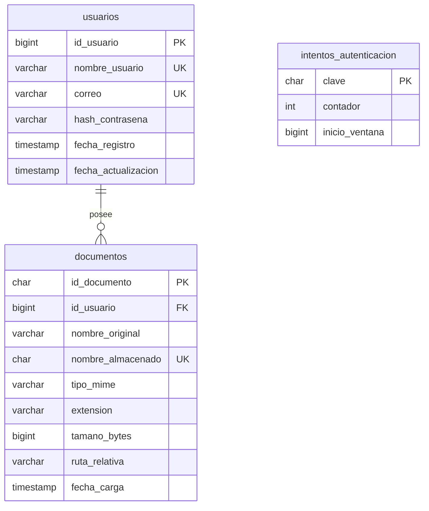

# Modelo de datos

Base principal: `documentos`. Base de pruebas: `documentos_pruebas`. InnoDB, utf8mb4 y consultas PDO preparadas. Las tablas tienen una sola responsabilidad y los binarios no se duplican en la base.

## Diccionario de datos

Todos los campos son NOT NULL; las fechas tienen valores predeterminados del servidor.

| Tabla.campo | Tipo | Finalidad y restricciones |
| --- | --- | --- |
| usuarios.id_usuario | BIGINT UNSIGNED | PK autoincremental; identidad interna |
| usuarios.nombre_usuario | VARCHAR(40) | Único; validación de 3–40 caracteres alfanuméricos o `_` |
| usuarios.correo | VARCHAR(254) | Correo válido y único |
| usuarios.hash_contrasena | VARCHAR(255) | Hash irreversible; nunca contraseña en texto plano |
| usuarios.fecha_registro | TIMESTAMP | Alta de la cuenta |
| usuarios.fecha_actualizacion | TIMESTAMP | Se actualiza al modificar la fila |
| documentos.id_documento | CHAR(32), ascii_bin | PK, 16 bytes aleatorios representados en hexadecimal |
| documentos.id_usuario | BIGINT UNSIGNED | FK a usuarios.id_usuario; ON DELETE RESTRICT |
| documentos.nombre_original | VARCHAR(180) | Nombre validado; solo metadato, no ruta física |
| documentos.nombre_almacenado | CHAR(64), ascii | Único; 32 bytes aleatorios sin extensión |
| documentos.tipo_mime | VARCHAR(100) | Tipo detectado y permitido por el servidor |
| documentos.extension | VARCHAR(5) | Extensión en minúsculas de la lista permitida |
| documentos.tamano_bytes | BIGINT UNSIGNED | Tamaño real, entre 1 y 10 485 760 bytes |
| documentos.ruta_relativa | VARCHAR(100) | ID de usuario / nombre generado; se vuelve a validar |
| documentos.fecha_carga | TIMESTAMP | Fecha de incorporación |
| intentos_autenticacion.clave | CHAR(64), ascii | PK SHA-256 de IP y categoría de acceso |
| intentos_autenticacion.contador | INT UNSIGNED | Intentos en la ventana vigente |
| intentos_autenticacion.inicio_ventana | BIGINT UNSIGNED | Instante Unix para caducidad a quince minutos |

Índices: usuarios_nombre_unico, usuarios_correo_unico, documentos_nombre_unico, documentos_propietario_fecha e intentos_ventana. La llave documentos_propietario_fk impide metadatos huérfanos. No se permite eliminar usuarios desde la aplicación.

Archivos SQL: `estructura/crear_base.sql` crea la base, `estructura/esquema.sql` crea las tablas comentadas y `estructura/relaciones.sql` define índices, unicidad y FK. Importar en ese orden. `migraciones/Instalador.php` aplica esos archivos y conserva/copia los datos de la instalación previa; no cambia el origen ni elimina tablas. `datos_prueba/usuarios.php` genera hashes explícitamente.

Cuenta web: SELECT/INSERT/UPDATE en usuarios; SELECT/INSERT/DELETE en documentos; SELECT/INSERT/UPDATE/DELETE en intentos_autenticacion. Sin permisos globales, DDL ni acceso a la base de pruebas desde la cuenta principal.
